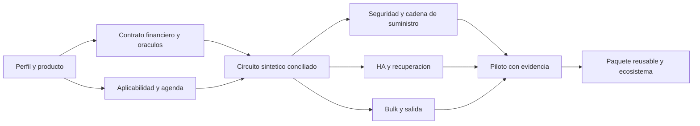

# Plan de implementación de Bank

**Estado:** propuesta para revisión del mantenedor. **Repositorio:** `andrescastiglia/bank`. **Base recuperada de GitHub:** `6a784b1af7f3aafffc4a87d3c4315bfabf090341`, con las PR de gobierno y seed ya integradas. **Inicio de observación:** 16/10/2026 01:47:13 UTC, equivalente a **15/10/2026 22:47:13 en America/Buenos_Aires**. Primera ventana regulatoria: **[15/10/2026 00:00:00, 15/10/2026 22:47:13)**, hora argentina. Las consultas posteriores al corte son evidencia de observación, no una ampliación silenciosa de la ventana.

**Licencia y autoridad:** continúa GNU GPL v2, conforme a [LICENSE](LICENSE) y [GOVERNANCE.md](GOVERNANCE.md). Únicamente `@andrescastiglia` fusiona a `main`. Las acciones siguientes son propuestas de documentación, implementación y pruebas; no constituyen despliegue, contratación, presentación regulatoria ni aceptación institucional. Las condiciones económicas corresponden a eventuales servicios comerciales, no a permisos para contribuir al software libre.

## 1. Decisión recomendada y hallazgos que cambian la prioridad

La arquitectura de autoridad financiera SQL, módulos delimitados, outbox/inbox, celdas y carga masiva preparada sigue siendo una base adecuada para construir un primer circuito demostrable. La principal brecha es **convertir especificaciones en software, contratos de datos, pruebas independientes y operación recuperable**. No hay evidencia de una aplicación bancaria desplegada, versiones efectivas de sus componentes, inventario productivo o ensayo financiero en el repositorio examinado. Esto es una limitación del alcance, no una afirmación sobre sistemas externos.

Se recomienda comenzar con **administración de una cartera de crédito y conciliación**, manteniendo pagos como alternativa si un operador identificado justifica esa elección. La decisión concreta sigue pendiente. Banca universal, PSAV, cambios y tarjetas no se activan por estar descritos en el catálogo. El trabajo común de integridad, seguridad y localización debe poder reutilizarse sin forks por cliente.

Los resultados materiales de esta revisión son:

1. **BCRA B13248, emitida el 15/10/2026:** actualiza SISCEN-0019 para 2027 a operaciones de **ARS 1.700 millones o más**, con `VALOR 2 = 1700`. El manual oficial confirma versión 03 desde enero de 2027. La biblioteca tenía reportes genéricos, pero no identificaba esta transición. Propuesta **P-REG-01**, condicional al perfil entidad financiera y al producto informable.
2. **CNV RG1172/2026:** emitida el 14/10, publicada el **15/10/2026**, vigencia general desde **16/10/2026** e información periódica del art. 40.b aplicable desde **1/11/2026**. Sustituye el régimen PSAV e incluye un anexo informativo detallado. Propuesta **P-REG-02**, condicionada a ofrecer actividades PSAV; no se extiende automáticamente a un prestamista o PSP por su marca.
3. **BCRA A8492:** el PDF recuperado coincide con el hash de la línea base; no es una nueva modificación. Se confirma el hito **1/11/2026** y la necesidad de ensayar el cambio de período en FR-RPT-021 y FR-RSK-019. Se incorpora a la agenda, conservando su identidad previa.
4. **Seguridad del stack propuesto:** los avisos PostgreSQL CVE-2026-14666 y CVE-2026-19385 tienen corrección publicada el **13/8/2026**. Afectan, respectivamente, revocación con RLS y herramientas de backup anteriores a las versiones corregidas. No son CVE descubiertas hoy ni prueban una instalación vulnerable de Bank; justifican fijar parches y probar esos caminos antes de operar.
5. **Inteligencia de amenazas:** el repositorio oficial de CISA agregó **CVE-2026-21589** el **15/10/2026**. Afecta productos Atlassian concretos; no se identificó su uso en Bank. Corresponde una comprobación de inventario de terceros/SDLC, no afirmar compromiso. El vencimiento de CISA para sus destinatarios no se adopta como plazo legal argentino.
6. **Cobertura parcial:** Boletín Oficial respondió 503 y COMARB 500 en los intentos registrados; otras fuentes tienen documentos/anexos o búsqueda cronológica pendientes. Se conservarán los gaps y no se declarará ausencia global de novedades. El índice BCRA recuperado contiene **103 TO y 55 RI**, más el manual SISCEN localizado fuera de esa faceta; no se leyeron íntegramente esos 158 documentos.

## 2. Alcance, método y trazabilidad de la evidencia

Se recuperaron `main`, instrucciones y seed mediante GitHub, incluido el conector de archivos. No se usó memoria de una corrida anterior como sustituto del estado remoto. En el momento de consulta no había PR abiertas ni rama `automation/regulatory-state`: `main` conserva el seed integrado por la PR #2, con checkpoints nulos y sin historia de corridas. La recuperación de la rama de estado debe partir de ese contenido, conservar su SHA/procedencia y registrar la ausencia como incidente operativo; no inventar una ejecución previa.

El [inventario del repositorio](docs/research/2026-10-15-integral/repository_inventory.json) registra **167 archivos y sus huellas**: documentación, referencias, catálogos, herramientas y skills. Se contrastaron arquitectura, mercado, cumplimiento, 8 ADR, 13 familias NFR, el catálogo de **1.016 FR en 32 módulos**, flujos y los **63 hallazgos / 14 paquetes** de la revisión existente. Los artefactos generados no se contaron como evidencia independiente de sus fuentes. Se utilizó lectura focal de los contratos y riesgos afectados; no se presenta como una auditoría jurídica independiente de cada FR ni como una prueba de producto.

El [manifiesto de consultas](docs/research/2026-10-15-integral/evidence.json) conserva **83 intentos, 69 respuestas HTTP 200**, URL solicitada/final, instante, hash de bytes y errores. HTTP 200 no implica texto pertinente, cobertura ni éxito: se identifican páginas de formulario, rutas descartadas y redirecciones a «no disponible». No se guardan cuerpos completos de sitios comerciales ni estándares restringidos. Las huellas HTML pueden variar por tokens/plantilla; una diferencia de bytes exige comparar contenido normativo antes de denominarla reforma.

| Clase | Qué acredita | Qué permanece pendiente |
|---|---|---|
| Norma y anexos primarios recuperados | Texto y secciones citados, sujeto y fechas expresas | Historial completo de modificatorias y aplicabilidad institucional cuando no se identificó operador |
| Índice oficial | Existencia y localización de documentos | Lectura del texto, anexos, orden temporal y todas las páginas necesarias |
| Documentación oficial de producto/estándar | Capacidad declarada o especificación publicada | Benchmark, instalación local, contrato, configuración o certificación de Bank |
| Repositorio | Diseño, referencias, herramientas y estado de revisión visibles | Implementación y eficacia operativa de controles bancarios |
| Propuesta de este plan | Trabajo, dependencias, oráculo y esfuerzo orientativo | Presupuesto, responsables designados, ejecución y aceptación |

Fuentes y propuestas usan identificadores estables en este plan. Los IDs FR/NFR/ADR/CTL y REV existentes se conservan. Una propuesta `P-*` no es un FR aceptado ni incrementa artificialmente la cobertura del catálogo. Los 63 hallazgos históricos siguen abiertos hasta obtener sus evidencias de cierre; la integración de gobierno resuelve la orientación GPL, sin probar procedencia de todas las dependencias ni cumplimiento operacional.

## 3. Eje legal, normativo, contable e impositivo

### 3.1 Perímetro antes de reglas

| Perfil activado | Obligación y alcance a determinar | Consecuencia para el diseño |
|---|---|---|
| Proveedor de software | Licencia, contratos, datos bajo instrucciones, cadena de servicios y seguridad | No asume por prestar software la licencia ni toda presentación del cliente; contrato asigna mantenimiento, evidencia y escalamiento |
| Prestamista / PNFC | Registro y obligaciones según sujeto, productos, contabilidad, consumidor, información y AML aplicable | Crédito/cobranza y reglas fiscales propias; no usar RI bancarios como sustituto |
| PSPCP / otros PSP | Función registrada, fondos de clientes, rieles, fraude, TI/SI y reportes por rol | Separar cuenta de pago, depósito, inversión y patrimonio propio; mantener integración y conciliación con custodio |
| Entidad financiera | Depósitos, prudencia, contabilidad BCRA, reportes y TI/SI según alcance | Activar A8492 y SISCEN-0019 cuando correspondan; conservar versiones por período |
| Agente CNV / PSAV | Categoría y actividades efectivas; regímenes particulares y UIF del sujeto | Manifestar alcance específico; no equiparar FCI, títulos y activos virtuales ni extender sus reglas entre sí |

El manifiesto de primera entrega debe identificar entidad legal, registro/licencia, producto, moneda, canal, jurisdicción, custodio, fuentes de datos y responsables. Hasta esa decisión, las obligaciones quedan condicionadas y el desarrollo utiliza datos sintéticos. Las pruebas de software no sustituyen aprobación contable, interpretación legal ni facultad de presentar información.

### 3.2 Registro de cambios y revalidaciones

| Propuesta / fuente | Hecho verificado y fechas | Aplicabilidad / brecha | Cambio trazable y aceptación requerida |
|---|---|---|---|
| **P-REG-01 — BCRA B13248**, [texto](https://www.bcra.gob.ar/archivos/Pdfs/comytexord/B13248.pdf), [metodología B12996](https://www.bcra.gob.ar/archivos/Pdfs/comytexord/B12996.pdf), [manual SISCEN](https://www.bcra.gob.ar/archivos/Pdfs/PublicacionesEstadisticas/siscen.pdf) | Emisión 15/10/2026; período 2027; umbral ARS 1.700 millones, código 1700; manual 0019 versión 03, páginas impresas 122–127. La fecha de publicación en BO no está acreditada por el índice, que la deja vacía | EF informantes; depósitos mayoristas a tasa fija en moneda nacional, 30–35 días conforme metodología. No identificado operador. FR-RPT-001/002/007/008/012/038 son marco genérico, falta el paquete específico | Versionar diseño/umbral/estrato y vigencia; conservar el tramo ARS 1.300 millones y código 1300 del 1/12/2025–31/12/2026 que muestra el manual. Probar límites, elegibilidad y rectificación histórica. Relación con RPT-01/04, CFG, ACC, NFR-09/11, ADR-05 y CTL-02/19 |
| **P-REG-02 — CNV RG1172/2026**, [texto y anexo](https://servicios.infoleg.gob.ar/infolegInternet/anexos/430000-434999/431259/norma.htm) | Art. 2 sustituye cap. III tít. XIV; art. 4 fija 1/11/2026 para información periódica art. 40.b; art. 5 vigencia al día siguiente del BO. Pie oficial: publicación 15/10/2026 | PSAV registrado y actividades/categorías pertinentes. Registro, custodia, sistemas, auditoría e información necesitan descomposición propia; no basta FR-RPT-033 ni una tabla genérica de inversiones | Paquete condicional por categoría; modelo de clientes/operaciones/custodia, activo y red, precisión, conciliación, AIF y evidencias. El anexo exige información mensual también sin operaciones para activos, y diferencia aún no iniciados. Validar art. 40/anexo con responsable antes de implementar |
| **P-REG-03 — BCRA A8492**, [texto y hojas](https://www.bcra.gob.ar/archivos/Pdfs/comytexord/A8492.pdf) | Emisión 15/10/2026, vigencia 1/11/2026; PDF idéntico a la base. Cambia sección 6, partida 102200 y control 538 | EF y reglas de presentación diferenciadas por grupo. Ya especificado en RPT-08, FR-RPT-021 y FR-RSK-019; falta ejecución demostrada | Conservar versión anterior/futura y ensayar corte 31/10–1/11, saldos diarios, promedio y control. No duplicar fuente ni cerrar el hallazgo por este plan |
| **P-REG-04 — CNV RG1173/2026**, [texto y protocolo](https://servicios.infoleg.gob.ar/infolegInternet/anexos/430000-434999/431260/norma.htm) | Emisión 14/10, publicación y vigencia 15/10/2026. Moderniza examen/registro de idóneos y contiene transición hasta 15/12/2026 para el mecanismo indicado en su texto | Personas y entidades alcanzadas por idoneidad; no exige que un core implemente una plataforma de exámenes | Evaluar si mandatos/roles de atención e inversión requieren constancia de idoneidad y vigencia. Vincular ENT/IAM/INV y operación; mantener la administración de exámenes fuera del core salvo decisión nueva motivada |
| **P-REG-05 — ARCA RG5814/2026 y RG4614 actualizada**: [biblioteca](https://biblioteca.arca.gob.ar/search/query/norma.aspx?p=t%3ARAG%7Cn%3A5814%7Co%3A9%7Ca%3A2026%7Cf%3A13%2F01%2F2026), [texto consolidado](https://www.argentina.gob.ar/normativa/nacional/resoluci%C3%B3n-4614-2019-330689/actualizacion) | Fuentes reconsultadas; no se acredita una reforma nueva del 15/10. TAX-07 y TAX-11 ya distinguen los regímenes | Selección de agente/título/exclusiones; biblioteca cronológica y novedades pendientes. No deducir umbrales por inflación automática ni confundir saldos propios y visibles de terceros | Instanciar TAX/RPT con diseño oficial, parámetros fechados, corte, rectificativa y acuse. Completar recuperación cronológica antes de afirmar vigencia íntegra |
| **P-REG-06 — UIF 14/2023, 200/2024 y 3/2026**: [bancos](https://www.argentina.gob.ar/normativa/nacional/resoluci%C3%B3n-14-2023-379085/actualizacion), [PSP](https://www.argentina.gob.ar/normativa/nacional/resoluci%C3%B3n-200-2024-407429/texto), [FP](https://www.argentina.gob.ar/normativa/nacional/resoluci%C3%B3n-3-2026-422247/texto) | Textos focales reconsultados junto con índices sectorial/transversal; no demuestran que no existan otras modificatorias | Mantener régimen del sujeto, calendarios distintos de LA/FT/FP y reserva; AML-01–12 ya relevados | Concretar reglas de caso, listas/versiones, hechos disparadores, suplencias y acceso. Preparar expedientes simulados; esta revisión no presenta ROS ni comunica a terceros |
| **P-REG-07 — AAIP / datos**: [47/2018 y anexos enlazados](https://www.argentina.gob.ar/normativa/nacional/resoluci%C3%B3n-47-2018-312662/texto) | Texto de resolución reconsultado; listado cronológico y recuperación completa de sus anexos pendientes | DATA-01–08, secreto y rol responsable/encargado. La obligación legal de seguridad y las medidas recomendadas tienen naturalezas distintas | Matriz finalidad/base/país/acceso/retención/hold y DPA. No importar plazo universal de 72 horas ni equiparar prescripción fiscal con permiso automático de borrar |

También se revisó [CNV RG1166/2026](https://servicios.infoleg.gob.ar/infolegInternet/anexos/430000-434999/430111/norma.htm), publicada y vigente desde 15/9/2026: modalidades de recepción/entrega de fondos para los sujetos alcanzados. Sirve para controlar origen/titularidad y rieles del módulo INV, sin tratarla como novedad del 15/10 ni extrapolarla a todo PSP. Las comunicaciones C102432/433 son estadísticas macro; C102434/435 aportan cotización/series. No son instrucciones para sustituir indiscriminadamente la tasa contractual: INT/FXT deben registrar fuente, fecha de dato, observación, revisión y fundamento de uso. Hay series con fechas de valor posteriores a la publicación; `observed_at` y fecha del dato no son equivalentes.

### 3.3 Agenda de implementación y pruebas regulatorias

| Hito | Responsable propuesto / activador | Preparación y oráculo |
|---|---|---|
| 16/10/2026, CNV1172 vigencia general | Legal/Cumplimiento si se opera como PSAV | Confirmar categoría y brechas frente al texto completo; no activar servicios sin encuadre |
| 1/11/2026, A8492 | Finanzas/Reportes de EF | Dataset diario/mes, partida 102200, control 538, diseño por grupo, reproducción anterior y nueva. Seleccionar calendario/versión según entidad |
| Desde 1/11/2026, información art. 40.b CNV1172 | Cumplimiento/Reportes de PSAV alcanzado | Determinar primer período exigible y presentación con lectura conjunta del art. 4 y anexo; su regla mensual es dentro de 15 días corridos de finalizado el mes. No inventar un primer vencimiento desconociendo situación de inicio/categoría |
| Año 2027, SISCEN-0019 versión 03 | Estadística/Reportes de EF informante | Fechas 31/12/2026 y 1/1/2027; monto por debajo/igual/encima de 1.700 millones; estrato 1700. Período anterior conserva versión/umbral |
| Exigibilidad por disparador, terceros/antifraude | Responsable institucional del régimen | Conservar fecha de recepción de documentación técnica u otro hecho exigido. No calcular vencimiento mientras falte su disparador |
| 15/12/2026, transición idoneidad CNV1173 | Sólo si existen personas/procesos alcanzados | Confirmar supuesto transitorio y evidencia de situación individual; no es fecha de implementación obligatoria de un motor de exámenes de Bank |

Para contabilidad e impuestos del piloto: definir plan de cuentas, devengamiento, base de interés, mora, refinanciación/prepago, redondeos, impuestos por concepto y reversos; separar CFT contractual, rendimiento contable, previsión regulatoria y deterioro. Los oráculos se revisan independientemente por Contabilidad/Fiscal. SIRCREB/SIRCUPA requieren agente, padrón y jurisdicción; el error COMARB deja una fuente pendiente y no habilita un padrón supuesto. La empresa proveedora tendrá su propio perfil fiscal y circuito de facturación/cobro, separado del ledger de los clientes.

## 4. Eje mercado, competencia y modelo de atención

### 4.1 Comparación observada

Las páginas siguientes se recuperaron en esta corrida. Son declaraciones de los proveedores, generalmente sin fecha de lanzamiento verificable, y **no acreditan implantaciones argentinas, precios, cuotas, latencias o certificaciones de Bank**. No se actualizan los números del mercado existente con datos no observados.

| Solución / fuente | Oferta declarada y lectura competitiva | Respuesta propuesta para Bank |
|---|---|---|
| [Bantotal](https://www.bantotal.com/) | Core, comercio exterior, cash management, ecosistema de servicios y BaaS; amplitud regional y operación de misión crítica declaradas | Competir por una cartera/circuito y una migración verificable, no prometer paridad inmediata de toda la suite |
| [Topaz](https://www.topazevolution.com/) | FinancialCore, fraude, canales/onboarding, pagos, originación e inversiones en ecosistema modular | Contratos de integración y matriz de responsabilidad de módulos especializados; medir costo/beneficio de integrar antes de construir |
| [Mambu](https://mambu.com/en) | Lending, depósitos, pagos e integración de IA en su oferta actual | Producto configurable con simulación, versiones y límites; no copiar personalización ilimitada ni asumir que una alianza global habilita un riel local |
| [Pismo, documentación](https://developers.pismo.io/pismo-docs/docs/welcome) | APIs, eventos/esquemas y herramientas de integración/reportes | Sandbox sintético, errores/estados explicables, contrato de eventos, reconciliación y documentación de lotes/asíncronos |
| [Thought Machine Vault Core](https://www.thoughtmachine.net/vault-core) | Ledger unificado y lógica de producto mediante smart contracts programables | Mantener ADR-05: configuración limitada y versionada; explorar extensiones sólo con aislamiento, límites y prueba de invariantes. No adoptar blockchain por la expresión comercial «smart contracts» |
| [Temenos](https://www.temenos.com/products/core-banking/) | Núcleo, pagos, riesgo/datos, partners y SaaS; transformación progresiva | Coexistencia y salida demostrables, expedientes regulatorios por perfil, paquete de servicio delimitado |
| [Finacle](https://www.finacle.com/) / [Oracle FLEXCUBE](https://www.oracle.com/financial-services/banking/flexcube/core-banking-software/) | Amplias familias de productos, cloud e integración/API; Oracle declara soporte de ISO 20022 | Aislar adaptadores de red y semántica monetaria; activar mensajes y contratos por riel, sin asumir compatibilidad total por usar XML/JSON |

La consulta puntual a la antigua ruta de un caso Mambu/Ualá devolvió 404; se utilizó la oferta actual de Mambu, sin retirar ni ampliar las conclusiones históricas sobre el caso. Para una decisión de compra se necesita RFI con mismo perímetro, país, roles, datos, volumen, soporte, localización, derechos y salida. No se contactó a proveedores o clientes.

### 4.2 Oportunidades priorizadas sin duplicar funciones existentes

| Propuesta | Dolor y módulo reutilizado | Diferencia a construir / métrica de aceptación | Condición de alcance |
|---|---|---|---|
| **P-MKT-01 — Servicing explicable** | CRE/INT/COL/LED/REC ya especifican el ciclo de crédito | Un flujo origina o importa contrato, calcula con versión, aplica cobranza, concilia y reconstruye asiento. Medir diferencias por titular, tiempo de implantación y esfuerzo manual por excepción | Elegir un producto y una cartera sintética antes de generalizar |
| **P-MKT-02 — Localización como paquete mantenible** | CFG/TAX/RPT/OPS y vigilancia | Cada reforma tiene aplicabilidad, vigencia, dataset, prueba comparativa y expediente de entrega. Medir tiempo detección–triage–propuesta y deuda normativa por fuente/perfil | No ofrecer «cumplimiento automático»; compromisos de servicio deben financiarse y contratarse |
| **P-MKT-03 — Portal de operación y atención** | CST/REC/ASY/OPS | Vista autorizada de estado durable, responsable, deadline, evidencia y próxima acción; una solicitud aceptada no se muestra liquidada. Medir antigüedad de pendientes, tasa de consulta repetida y tiempo de resolución | Excluir ROS y datos de otras entidades; accesibilidad del recorrido seleccionado |
| **P-MKT-04 — Sandbox y adaptadores** | ASY/COR/IAM y NFR-08 | OpenAPI, fixtures, webhooks verificables, simulador de timeout/duplicados, exportación y guía de integración | Sin credenciales reales ni motor que envíe órdenes productivas; certificar cada riel por separado |
| **P-MKT-05 — Migración y salida como diferenciador** | MIG/DAT/LED, ADR-08 | Cohorte cargada por lotes, conciliada, activada y reconstruida en destino independiente; medir ventana completa y costo total de implementación | Cero exposición PREPARED a operación ordinaria; no vender migración sin interrupción no medida |
| **P-MKT-06 — Finanzas embebidas e IA asistida** | COR/AIG/CST | Más adelante: atención que consulta evidencia autorizada o ayuda a clasificar excepciones, con auditoría y revisión humana | Ningún agente autoriza pagos, modifica tasas o produce decisiones adversas sin control/encuadre. No es dependencia del primer ledger |

Para sostener el proyecto: separar mantenibilidad comunitaria de una oferta eventual de implantación, soporte, operación gestionada o localización compatibles con GPL. El costo por cliente incluye celda, HA, guardia, observabilidad, terceros, cambios normativos, migración y salida. Estimar precio sólo con alcance y costos reales. No usar números de cuentas del país como TAM de reemplazos de core ni tratar ARR como caja.

## 5. Eje innovación tecnológica y arquitectura

### 5.1 Decisiones que se mantienen

| Decisión actual | Riesgo que resuelve | Implementación y verificación pendientes |
|---|---|---|
| ADR-01/02: módulos y autoridad SQL por entidad | Fondos, límites y restricciones coherentes | Modelo lógico, guardianes transaccionales y orden de locks; dinero exacto; pruebas de doble gasto, revocación y períodos |
| ADR-03: outbox/inbox y jobs durables | Pérdida de trabajo, duplicados y efectos externos ambiguos | Transacción dominio–auditoría–outbox; inbox con identidad económica; estados UNKNOWN y consulta al tercero antes de reintentar |
| ADR-04: HA local y DR regional con condiciones | Fallos de zona/región y doble writer | Fencing verificable, punto de recuperación, restauración con IAM/KMS y reconciliación antes de reapertura |
| ADR-05: configuración versionada | Cambios fiscales/producto retroactivos o no reproducibles | Esquema, vigencias sin solapamiento ambiguo, simulación/dual control y vínculo operación–versión |
| ADR-06: aislamiento por celda | Fuga y mezcla de obligaciones entre entidades | Identidad de entidad derivada de autorización, fronteras de soporte/bus/archivo y pruebas de revocación/aislamiento |
| ADR-07: Go/PostgreSQL, servicios acotados | Complejidad y costo operacional | Versiones y proveedor con soporte, licencias, garantías de persistencia, SBOM, costos y salida verificados |
| ADR-08: bulk logged y cohortes | Ventana de migración y exposición de cartera incompleta | Staging, validación set-based, idempotencia entre corridas, barrera de origen y activación por época, ensayadas |

Los ADR continúan **Propuestos**. Este informe no los acepta por el mantenedor ni reemplaza sus alternativas. No hay motivo demostrado para introducir un ecosistema de microservicios o un nuevo motor distribuido antes del primer flujo.

### 5.2 Avances evaluables y criterio de adopción

| Propuesta / evidencia | Uso concreto y beneficio esperado | Riesgo / experimento que decide |
|---|---|---|
| **P-TEC-01 — PostgreSQL 18 soportado y parcheado**, [release 18](https://www.postgresql.org/docs/18/release-18.html), [18.6](https://www.postgresql.org/docs/release/18.6/) | AIO puede mejorar scans/vacuum; estadísticas preservadas por pg_upgrade y mejoras de COPY ayudan a mantenimiento/carga | Ninguna mejora prueba p99 del ledger. Comparar mismo dataset, durabilidad, restricciones y controles; fijar parche de servidor **y clientes**. 18.6 corrige los dos avisos citados; verificar si existen parches posteriores del proveedor |
| **P-TEC-02 — UUIDv7 y restricciones temporales**, release 18 | IDs ordenados para trazabilidad o restricciones de intervalos de configuración | No sustituyen identidad de negocio, orden autoritativo ni reloj de vigencia. No migrar claves por moda; benchmark y análisis de contratos existentes |
| **P-TEC-03 — Semántica OpenTelemetry versionada**, [especificación observada 1.44.0](https://opentelemetry.io/docs/specs/semconv/) | Convenciones compatibles para HTTP/SQL/jobs, correlación de recepción a efecto y medición de backlog | Estabilidad por grupo, cardinalidad y PII. No copiar datos de clientes en labels; auditoría material permanece durable y separada del muestreo de trazas |
| **P-TEC-04 — Perfil de APIs financieras**, [FAPI 2.0 final, 22/2/2025](https://openid.net/specs/fapi-security-profile-2_0-final.html) | Evaluar PAR, PKCE, tokens ligados al emisor mediante mTLS o DPoP y validación estricta en integraciones externas | Es estándar técnico propuesto, no ley argentina universal. Evaluar compatibilidad del IdP/clients, revocación, replay, nonce y vinculación con autorización de negocio |
| **P-TEC-05 — Automatización de workflows sólo ante necesidad** | Inicialmente tablas de jobs, leases/epochs, prioridades/deadlines y estados verificables; orquestador si aporta recuperación real | Medir costo de operar otro motor y frontera de autoridad. Un workflow no hace atómico un pago externo ni reemplaza outbox/inbox |
| **P-TEC-06 — Proyecciones y contratos reproducibles** | Lecturas/reportes asíncronos con watermarks, esquema versionado y replay controlado | No autorizar fondos en caché o proyección; no exponer datos PREPARED ni reenviar efectos externos al reconstruir |

La página oficial de PostgreSQL anuncia una **RC de 19 el 15/10/2026**. Se registra como información de ciclo de versiones; no se propone reemplazar la línea base soportada por una RC. Los avances identificados en 2025 siguen siendo oportunidades de adopción, no novedades de lanzamiento de esta ventana.

### 5.3 Asincronía, latencia, capacidad y bulk

La respuesta inmediata se limita a identidad/autorización, invariantes financieras, reserva/límite y commit requerido por la operación. Importaciones, generación de reportes, conciliación, comunicaciones y cálculos demorables se procesan asíncronamente con recepción durable, `operation_id`, estado consultable, deadline y propietario. La autorización de un pago o la disponibilidad de fondos no se posterga si el riel exige decisión inmediata. No devolver éxito financiero por un `202` o por publicar en Kafka.

Mantener como hipótesis de ensayo el perfil ya documentado: 250.000 cuentas/contratos, 100 comandos monetarios/s sostenidos, pico 500/s y hasta 1.000 lecturas/s; transferencia interna p95/p99 ≤100/200 ms, saldo consistente ≤50/100 ms y antigüedad ordinaria de outbox p99 ≤5 s. Son **objetivos propuestos**, no benchmark ni obligación legal. Medir latencia extremo a extremo con carga ofrecida/completada, error, contención, lag y capacidad tras fallo; no sumar percentiles de servicios.

La carga inicial utilizará `COPY FROM STDIN` a staging logged, columnas/mapeos explícitos y rol mínimo; nunca `COPY PROGRAM` ni SQL arbitrario del cliente. Si una política RLS limita COPY, usar staging aislado o inserciones autorizadas compatibles, sin deshabilitarla. Los lotes conservan manifiesto/hash/origen/transacción económica completa; `ON CONFLICT DO NOTHING` no resuelve diferencias de contenido. El checkpoint se confirma con la aplicación financiera del conjunto, no por terminar la lectura de un chunk.

Separar apertura conciliada de historia completa, manteniendo una única autoridad por contrato. PREPARED permanece fuera de saldos, mayor, RI y efectos ordinarios. Medir la ventana completa: recepción, validación, aplicación, índices/estadísticas, WAL/réplicas, reconciliación, aprobación y activación. El retorno tras actividad exige conciliar novedades y liquidaciones; restaurar un backup no deshace pagos externos. PostgreSQL 18/18.6 cambia comportamientos de COPY/psql: fijar versiones de cliente y probar terminadores/CSV y fallos sin enviar archivos no confiables a herramientas privilegiadas.

## 6. Eje crítico: seguridad informática

### 6.1 Avisos primarios y exposición

| Propuesta / fuente | Hecho y fecha | Exposición de Bank / acción |
|---|---|---|
| **P-SEC-01 — [CVE-2026-14666](https://www.postgresql.org/support/security/CVE-2026-14666/)** | Caché de políticas RLS puede conservar permisos tras cambios de roles/propiedad. Corrección 13/8/2026; versiones previas a 18.6/17.11/16.15/15.19/14.24 afectadas | PostgreSQL 18 es propuesta, no versión desplegada. Revisar servicio y parche efectivo, pools/planes reutilizados; ensayo de revocación en sesiones previas y dos entidades. Refuerza FR-IAM-009/030, NFR-05-C02 y ADR-02/06 |
| **P-SEC-02 — [CVE-2026-19385](https://www.postgresql.org/support/security/CVE-2026-19385/)** | `pg_dump` anterior a esas versiones puede ejecutar código como su usuario de SO al procesar una lista de transformaciones manipulada. Corrección 13/8/2026 | Inventariar clientes, imágenes de backup, migración y restauración, aunque el servidor sea gestionado. No leer dumps/orígenes no confiables con agentes que tengan secretos o privilegios ajenos; ensayo aislado por equipo autorizado |
| **P-SEC-03 — [CISA KEV oficial](https://raw.githubusercontent.com/cisagov/kev-data/develop/known_exploited_vulnerabilities.json), [aviso Atlassian](https://confluence.atlassian.com/security/cve-2026-21589-arbitrary-file-access-vulnerability-impacts-multiple-products-1870495748.html)** | KEV incorpora CVE-2026-21589 el 15/10/2026; aviso proveedor 5/10/2026, acceso no autenticado a archivos en varios productos Data Center. El aviso distingue Cloud y parches por producto | Uso no acreditado. Inventariar herramientas propias/proveedores antes de abrir una remediación aplicable. Si existen, seguir versión/mitigación oficial y revisión de exposición por su responsable. La fecha KEV 18/10 no impone obligación general argentina |

No se ejecutaron ataques, escáneres contra terceros ni pruebas de explotación. Un CVE relevante al stack no prueba presencia de una versión vulnerable, acceso explotable o compromiso. Tampoco un escáner sin resultados demostraría seguridad del circuito financiero.

### 6.2 Modelo de amenazas y controles verificables

| Vector / frontera | Escenario material | Control y prueba propuesta | Trazabilidad existente |
|---|---|---|---|
| Identidad humana, soporte y recuperación | Robo de sesión, phishing o recuperación que evita MFA | Autenticadores según riesgo, recuperación independiente, revocación autoritativa, privilegio temporal; usar [NIST 800-63 Rev.4 final](https://pages.nist.gov/800-63-4/) como guía. Probar sesión anterior, pérdida de autenticador y recuperación sin cuenta compartida | IAM, NFR-05, CTL-09/10; REV-SEC-01/03 |
| Autorización por objeto/propiedad/función | Usuario cambia entidad/cuenta o campos protegidos en API, reporte o evento | Denegación por defecto en cada ruta y objeto, pertenencia derivada del principal; pruebas BOLA/BFLA, asignación masiva y exportaciones entre entidades | FR-IAM-004, ADR-06, [OWASP API 2023](https://api-security.owasp.org/editions/2023/en/0x11-t10/) |
| Aprobaciones e identidades delegadas | Misma persona usa dos cuentas o cambia importe/destino tras aprobación | Doble intervención por persona/control delegado, digest de operación y nueva aprobación ante cambio material; prueba con cuentas distintas de una misma persona | IAM, CFG, RPT, NFR-05-C03; REV-SEC-02 |
| Concurrencia y dinero | Doble gasto, duplicación de período, redondeo incoherente o liberación por TTL | Guardianes SQL, dinero exacto, unicidad económica, reservas y reversos auditados; historias con carreras y oráculo independiente | LED/BAL/INT/ASY, ADR-02/03, NFR-01 |
| APIs, webhooks e integraciones | Callback falsificado/repetido, token replay, SSRF o uso de datos externos no validados | Validar firma/emisor/audiencia, credenciales por entorno, referencia y contenido, allowlist/egress y defensa DNS/IP según integración; reintento mantiene identidad. Sandbox para pruebas | ASY/PAY/COR, NFR-08, P-TEC-04 |
| Colas, batch y aislamiento | Flood de trabajo, DLQ olvidada, payload malicioso o replay que ejecuta pagos | Cuotas por entidad/costo, priorización/deadlines, esquemas, DLQ con dueño, consumidores sin facultad externa en replay; probar caída y tormenta de reintentos | ASY/OPS, NFR-04/07, ADR-03 |
| Claves, copias y archivo | Clave perdida, soporte extranjero no declarado, backup exfiltrado o restauración que revive datos restringidos | KMS/secretos con roles y recuperación independientes, inventario de ubicaciones/servicios, cifrado por clasificación, holds/retención en restore; probar integridad y acceso sin secretos en trazas | DAT/OPS, NFR-06/07; REV-SEC-03/05 |
| CI y cadena de suministro | Artefacto alterado, acción mutable, dependencia o credencial comprometida | Versiones/digests, SBOM/licencias, procedencia y firma verificadas, análisis de dependencias/secretos y retest. Usar [SSDF 1.1 final](https://csrc.nist.gov/pubs/sp/800/218/final); no presentar borrador como norma adoptada | FR-OPS-025/026, CTL-15; REV-SEC-06 |
| Disponibilidad y resiliencia | DDoS, región perdida, dos writers o infraestructura recuperada sin claves | Backpressure/límites y contingencias por riel; BIA, fencing, punto SQL/broker, restore y reconciliación; no prometer RPO regional cero sobre réplica asíncrona | ADR-04, NFR-02/03, REV-SEC-04/08 |
| Fraude, AML y modelos | Cuenta tomada, mulas, listas vencidas o asistente que filtra ROS/autoriza acciones | Antifraude en circuito autorizado, listas/versiones, casos segregados, propósito y revisión de modelos. Probar indisponibilidad y mensajes que intentan ampliar permisos | FRD/AML/AIG, CTL-07/08; BCRA-T08 |
| Carga masiva y fuentes | Archivo manipulado, duplicado entre corridas, SQL/dump que hereda privilegios | Hash/manifiesto, límites de tamaño, parser aislado, staging y rol mínimo, comparación de contenido; nada PREPARED en operación ordinaria | MIG, ADR-08, NFR-10; P-SEC-02 |

[ASVS 5.0.0](https://owasp.org/projects/asvs) aporta requisitos verificables con versión e ID por endpoint; API Top 10 aporta escenarios, no una certificación exhaustiva. PCI DSS, ISO y Swift se activan según datos, contratos, redes y perfil; no se incorporan enteros como ley argentina. La página pública de [PCI SSC](https://www.pcisecuritystandards.org/document_library/) se recuperó, sin atribuir una evaluación PCI al producto. La revisión completa de ediciones/contratos ISO y Swift queda pendiente.

Se propone, como política interna a decidir, triage el mismo día para explotación conocida/exposición financiera y antes de cada release material para dependencias alcanzadas. El plazo de remediación se define por exposición, impacto y mitigación, registrando excepciones y retest; no se inventa un SLA legal universal por CVSS. La seguridad básica se implementa **desde la Fase 1**; la Fase 2 la profundiza y verifica.

## 7. Plan modular de implementación

### 7.1 Estimación y capacidad

Las estimaciones son **personas-semana de trabajo especializado**, no semanas calendario ni cotizaciones. Son rangos preliminares para una entrega acotada, con incertidumbre aproximada de ±50% hasta seleccionar perfil, contratos de riel y modelo contable. Incluyen análisis/implementación/verificación de cada paquete; excluyen contratación, certificaciones, tarifas externas, esperas de contraparte y un core bancario universal. Una sola persona no sustituye la independencia de revisión contable/seguridad u operación requerida.

Impacto se expresa por pérdida financiera/regulatoria evitada o capacidad entregable, sin inventar un retorno monetario. P0 bloquea el hito indicado; no impide investigación o desarrollo sintético. Las fechas legales de la sección 3 prevalecen sobre una secuencia ilustrativa: si un operador real necesita el cambio antes, el paquete correspondiente se atiende primero o se mantiene inactivo el alcance.

### 7.2 Fase 1 — Crítico / Regulatorio

| Paquete | Entregable, responsable propuesto y dependencia | Impacto / esfuerzo | Criterio verificable de salida |
|---|---|---|---|
| **F1-01 — Perímetro y manifiesto del piloto** | Producto + Legal/Cumplimiento + Contabilidad: elegir ruta y sociedad/rol, activar FR por flujo y exclusiones; usar charter existente. Sin dependencia técnica | Evita activar actividades/regímenes incorrectos; **1–2** | Cada flujo tiene actor, licencia/registro o condición pendiente, moneda/jurisdicción, tercero, dueño y FR/dependencias. No hay promesa de todos los 1.016 FR implementados |
| **F1-02 — Vigilancia y calendario durable** | Cumplimiento + mantenedor: recuperar rama de estado, agenda/gaps, responsabilidad y protocolo de concurrencia; depende de fuentes oficiales, no de un despliegue | Conserva alertas y plazos; **1–2** | Bitácora/estado validados, sin perder historia; PR deduplicadas; 503/500 no avanzan checkpoint. No abrir PR de estado como requisito diario de funcionamiento |
| **F1-03 — Contratos de dominio y núcleo financiero mínimo** | Arquitectura/Ingeniería + QA: esquema SQL, comandos/estados, dinero exacto, guardianes, idempotencia, auditoría y outbox; depende F1-01 | Reduce mayor pérdida por doble efecto/inconsistencia; **6–10** | Flujo sintético completo con doble gasto, revocación concurrente, duplicados, caída entre pasos y corrección; cero diferencias inexplicadas por entidad/titular/moneda |
| **F1-04 — Política contable y fiscal del flujo** | Contabilidad/Fiscal + Ingeniería + QA: plan/asientos, intereses, IVA/retenciones si aplican, cobranzas y cierre; depende F1-01 y contrato de F1-03 | Exactitud de deuda/ingreso/impuesto; **3–5** | Vectores con importes exactos revisados independientemente; fin de mes, mora, prepago, reverso y reapertura conciliados. Sin usar tipos flotantes para dinero |
| **F1-05 — Localización y transiciones aplicables** | Reportes + Cumplimiento + QA: P-REG-01/02/03 según perfil, diseños versionados y tests de frontera; depende F1-01 y datos F1-03/04 | Evita versión/umbral/población incorrectos; **2–4** para adaptadores bancarios acotados | B13248 y A8492 sólo si aplican; dataset y archivo/versiones reproducibles, validación y rectificación. **Paquete PSAV completo no está incluido:** requiere estimación separada tras descomponer RG1172 |
| **F1-06 — Aceptación, permisos y evidencias mínimas** | QA + Seguridad + Operaciones: matriz caso/oráculo/entorno, permisos negativos, contingencias de fuentes y calendario; integra F1-03/04/05 | Impide confundir CI documental con producto apto; **2–4** | Todo escenario crítico del flujo tiene esperado/observado, versión y responsable; prueba fallida material conserva bloqueo del hito. Ninguna presentación externa es automática |

**Esfuerzo agregado Fase 1: 15–27 personas-semana.** Los seis paquetes se solapan parcialmente; la suma no implica calendario. La puerta de salida es una demostración sintética íntegra del producto elegido y un inventario explícito de pendientes, antes de autorizar dinero/datos reales.

### 7.3 Fase 2 — Seguridad / Tecnología

| Paquete | Entregable, responsable propuesto y dependencia | Impacto / esfuerzo | Criterio verificable de salida |
|---|---|---|---|
| **F2-01 — Amenazas, IAM y APIs** | Seguridad/Arquitectura: modelo por ruta/objeto, personas/delegación, recovery, perfil FAPI evaluado y ASVS; depende F1-01/03 | Evita acceso/fraude y mezcla entre entidades; **3–5** | Pruebas negativas por objeto/función/campo, dos entidades, misma persona con dos cuentas, revocación y recovery; conformidad FAPI no se declara sin suite/alcance |
| **F2-02 — SDLC, parches y procedencia** | Ingeniería/Seguridad: inventario de componentes de producto/terceros, SBOM/licencias, parches servidor/clientes y build verificable; puede comenzar con F1 | Reduce compromiso de herramientas/release; **2–4** | Versiones efectivas, avisos aplicables/descartados con fundamento, retest y rollback; P-SEC-01/02/03 contrastados contra inventario. No hay componentes `latest` sin política |
| **F2-03 — HA, recuperación y claves** | SRE + Seguridad + Finanzas: BIA, topología/proveedor/costos, fencing y DR; depende modelo financiero y raíces de confianza | Evita pérdida/duplicación tras fallo; **4–7** | Pérdida de writer/zona/región y restauración limpia con punto recuperado, RTO/RPO observados y conciliación. Compromiso contractual sólo dentro de lo probado/aceptado |
| **F2-04 — Jobs, rendimiento y observabilidad** | Ingeniería/SRE/QA: deadlines, backpressure, DLQ, replay, OTel y carga realista; depende F1-03 | Baja latencia sostenible y pendientes controlados; **3–5** | Medición de percentiles extremo a extremo, offered/completed/errors, edad de cola y catch-up con ingreso continuo/fallo; cero efectos externos por replay |
| **F2-05 — Migración y salida** | Datos/Migración + Contabilidad + Operaciones: importador bulk y cohortes, cutover y retorno; depende F1-03/04 y F2-03 | Implementación repetible y portabilidad; **4–6** | Ensayo completo con chunks cruzados, checksum distinto, duplicado entre corridas, delta tardío, PREPARED aislado y un solo escritor; reconstrucción independiente |
| **F2-06 — Privacidad, terceros y operación** | Legal/Datos/Seguridad/Operaciones: DPA, mapa de países/servicios, retención/hold, guardia y día de negocio; depende perfil y ofertas efectivas | Secreto, continuidad y servicio financiable; **2–4** | Otro operador ejecuta runbooks/tabletop con suplencia, reloj real y evidencias; restore respeta retención/hold; subproveedores y acceso supervisor trazados |

**Esfuerzo agregado Fase 2: 18–31 personas-semana.** El hito es preparación del piloto bajo el perfil elegido: ensayos materiales y roles/contratos efectivos. Una vulnerabilidad explotable en un activo usado se atiende al detectarse, sin esperar nominalmente esta fase.

### 7.4 Fase 3 — Mercado

| Paquete | Entregable, responsable propuesto y dependencia | Impacto / esfuerzo | Criterio verificable de salida |
|---|---|---|---|
| **F3-01 — Paquete reusable de producto** | Producto/Ingeniería: P-MKT-01/02, manifiesto/parametrización/documentación y ejemplos; depende F1 y verificación F2 | Diferenciación por localización explicable; **3–5** | Segundo conjunto sintético compatible sin fork; cambios de parámetros/versiones y efectos explicables |
| **F3-02 — Sandbox y conectores** | Ingeniería/Integraciones: P-MKT-04, SDK/contratos, simuladores y guía; depende F2-01/04 | Reduce esfuerzo de integración; **3–5** | Integrador ajeno al autor completa recorrido con timeout, duplicado y exportación; ninguna credencial o envío real |
| **F3-03 — Atención y operación de excepciones** | Producto/UX/Operaciones: P-MKT-03, backoffice accesible y métricas; depende estados y permisos verificados | Menos tickets y decisiones manuales opacas; **2–4** | Recorridos muestran recibido/pendiente/ejecutado/liquidado correctamente; prueba de accesibilidad y privacidad por rol |
| **F3-04 — Sostenibilidad y evaluación competitiva** | Mantenedor/Producto y eventual responsable comercial/contable: RFI comparativa, costo por celda y opciones de soporte; puede investigarse desde F1 | Evita servicios vendidos por debajo del costo; **1–2** | Modelo con costos/hipótesis explícitos y sensibilidad; licencia/entrega compatibles; no presenta entrevistas/cotizaciones no realizadas |

**Esfuerzo agregado Fase 3: 9–16 personas-semana. Total orientativo: 42–74 personas-semana**, antes de productos especializados o esperas externas. Investigación de mercado puede correr temprano; ampliar funciones queda detrás de integridad, seguridad y evidencia.

Si la capacidad efectiva es 4 personas-semana por semana, la división aritmética da 10,5–18,5 semanas de esfuerzo idealizado, **no una fecha comprometida**: dependencias, especialistas parciales, revisión, integración, contingencias y soporte aumentan la duración. Con una sola persona no es defendible prometer a la vez toda la suite y operación independiente 24×7. Al terminar F1-01 debe reestimarse un calendario por capacidad real y camino crítico.

### 7.5 Dependencias y puertas de entrega

Las puertas son decisiones/evidencias por riesgo, no permisos para investigar. Un piloto real requiere al operador y sus facultades, contratos/datos/registros y aceptación correspondientes; este plan sólo prepara ese trabajo. No se autoriza un despliegue por fusionar esta PR.

## 8. Matriz de propagación a documentos, controles y skills

Los enlaces apuntan a fuentes vigentes; los entregables que se proponen a continuación no se consideran ya creados. No se renumeran requisitos ni se altera retrospectivamente el backlog para declararlo resuelto.

| Trabajo de este plan | Documentos/FR a desarrollar o concretar | NFR / ADR / CTL | Revisión existente y skills a aplicar |
|---|---|---|---|
| Perímetro, alcance y servicio | [Mercado](docs/market_analysis.md), [scope](docs/functional/scope.md), ENT/COR, charter y business case existentes | NFR-12/13; ADR-01/06/07; CTL-17 | REV-COM-01/03/06/07/08/12; REV-LEG-01/02/03; WP-01/03/04; core-project-review y core-pilot-kickoff |
| P-REG-01, SISCEN | [Cumplimiento](docs/compliant.md), [RPT](docs/functional/25-reportes-localizacion.md), CFG/ACC; desarrollar paquete específico de registro y oráculos | NFR-09/11; ADR-05; CTL-02/19 | REV-LEG-10, REV-ACC-04, REV-QA-05; WP-05/11; core-regulatory-watch, core-bancario-argentina y core-fr-requisitos |
| P-REG-02/04, CNV | LAW-18, INV/RPT/ENT/IAM/COR y alcance especializado pendiente; no equiparar PSAV y valores negociables | NFR-05/06/11; ADR-05/06; CTL-09/17/19 | REV-LEG-01/08/10; WP-01/11/14; coordinadores regulatorios y FR antes de ampliar el denominador |
| A8492 y demás agenda | RPT-08, FR-RPT-021/038, FR-RSK-019, diseños y casos | NFR-09/11; ADR-05; CTL-06/19 | REV-LEG-10, REV-QA-05; mantener core-regulatory-watch y criterios NFR pertinentes |
| Modelo financiero/oráculos | LED/BAL/CRE/INT/COL/TAX/REC y [flujos](docs/functional/flows.md); contratos de comando y schema SQL a producir | NFR-01/04/11; ADR-02/03; CTL-01–06 | REV-ACC-01/02/03/04, REV-ARC-01/02/05, REV-QA-04/05/06; WP-05/06/09; skills de autoridad SQL, asincronía e integridad |
| P-SEC-01/02/03 | IAM/OPS/MIG/DAT, inventario efectivo, matriz de autorización y paquetes de parche/restore | NFR-05/06/09/10; ADR-02/06/07/08; CTL-09/10/15 | REV-SEC-01/02/03/05/06, REV-ARC-09; WP-08/11; skills de seguridad, privacidad, stack y bulk |
| HA, latencia y jobs | [Arquitectura](docs/achitecture.md), OPS/ASY/PAY, contratos de proveedor/capacidad y ensayos | NFR-02/03/04/07/12; ADR-03/04/07; CTL-12/13/14 | REV-ARC-04/06/07/08 y REV-SEC-04/07/08/09; WP-07/10; skills de HA, capacidad, asincronía y operación |
| Migración/atención/portabilidad | MIG/DAT/CST/REC, mapeos, manifiestos y protocolo de salida | NFR-08/10/13; ADR-08; CTL-16/18/20 | REV-ARC-03, REV-SEC-10/11/12; WP-10/13; skill de carga masiva y core-pilot-kickoff |
| Gobierno de requisitos y evidencia | Catálogo/coverage, revisión y metadatos de skills; manifiestos de casos y cambios semánticos | NFR-09/11; CTL-15/19 | REV-QA-01/02/03/08; WP-12; core-fr-requisitos, core-nfr-calidad y core-adr-arquitectura |

No se necesita otro skill genérico de «revisar el proyecto»: ya existe. Las mejoras propuestas para los skills actuales son concretar inventario de versiones/avisos, paquetes de norma por período y reglas de cierre con evidencia; cada modificación de comportamiento se propagará a caso/oráculo y documentación. El contrato de retiro de FR sigue pendiente: el generador exige contigüidad y no debe forzarse renumerando IDs históricos.

## 9. Propuestas acotadas listas para desarrollo

### P-REG-01: adaptador versionado SISCEN-0019

**Hecho:** B13248 y el manual oficial fijan año/estrato/umbral. **Interpretación:** el ámbito es el informante y operaciones definidas en B12996/manual, no todo contrato de depósito ni todo usuario del core. **Propuesta:** preparar un módulo de extracción/validación dentro de RPT, con configuración fechada en CFG y datos ACC/LED reconciliados. Registro normativo canónico `BCRA|B|13248|2026|AR`, relacionado con B12996 y versión del manual. No modificar automáticamente tasas comerciales al cambiar un umbral estadístico.

Entregables: diseño de registro/campos del manual, conjunto sintético esperado/observado, versión de parámetro con revisión, archivo/manifiesto y procedimiento de rectificación. Debe definirse precisión/unidad de cada campo, redondeo, fechas a declarar, población/exclusiones y línea de cierre sin datos. El manual es fuente de esos campos, no una plantilla supuesta a partir del título.

Criterios a implementar, **todavía no ejecutados como software bancario**:

- Período 2027: ARS 1.699.999.999,99 no ingresa por monto; ARS 1.700.000.000,00 y superior sí, si satisfacen los demás criterios. `VALOR 2 = 1700`, sin error de unidad miles/millones.
- Plazo 30 y 35 días elegible; 29 y 36 no para este estrato; moneda o modalidad de tasa no admitida queda excluida con motivo.
- Datos de diciembre de 2026 mantienen versión/código/umbral anterior, aun al rectificarse en 2027. Una regla nueva no reinterpreta la historia.
- Ausencia de operaciones informa la estructura de cierre requerida por el manual; no se sustituye por omitir presentación ni inventar operaciones cero.
- Corte incompleto, diferencia contable o catálogo ambiguo impide estado listo. Generar el archivo no implica presentarlo ni haber sido aceptado.

Esta propuesta puede incorporarse mediante PR documental y posterior PR de implementación cuando exista el módulo. Su aceptación no acredita que Bank ya genera SISCEN-0019.

### P-REG-02: decisión y paquete especializado PSAV

**Hecho:** RG1172 sustituye el capítulo y agrega régimen informativo detallado. **Interpretación:** el catálogo genérico de inversiones no demuestra implementación de custodia de activos virtuales. **Propuesta inmediata:** determinar con Legal/Producto si PSAV entra en un manifiesto activo; si no, conservar novedad/agenda como condicional. Si entra, separar contratos, categorías, patrimonio/clientes, claves/custodios, seguridad/auditoría, obligaciones de información y canales antes de escribir código de custodia.

El paquete de información debe modelar clientes, operaciones, activos/redes y tenencias; distinguir activo de moneda fiat y precisión de unidades de dinero contable. El anexo contempla PSAV_014 y hechos relevantes PSAV_015 para la situación de inicio. Probar población activa sin operaciones, aún no iniciada, correcciones, completitud del corte, conciliación de custodia y versiones. Validar el primer período y vencimiento por sujeto, sin usar el 1/11 como fecha universal de presentación. No asignar un nuevo FR «cumplir CNV» ni aceptar toda la extensión por una referencia LAW-18.

### P-SEC-01/02: parches y prueba de revocación/backup

**Hecho:** avisos del fabricante precisan vulnerabilidad/versiones corregidas. **Interpretación:** relevancia al stack propuesto y a sus clientes de backup, con exposición actual sin evaluar. **Propuesta inmediata:** fijar inventario/parches/soporte y modelo de privilegios; preparar escenarios negativos de sesión RLS previa y restauración/importación de contenido no confiable. Si un proveedor prueba un backport, registrar evidencia exacta; no descartar por un número de versión sin contrastar su política. Si el componente no existe, registrar no aplicabilidad actual y conservar el control para su introducción.

## 10. Cobertura real, gaps y persistencia

| Canal | Cobertura observada | Estado de esta corrida / recuperación pendiente |
|---|---|---|
| BO primera sección | Tres rutas devolvieron 503; sin edición/suplementos/anexos recuperados | **UNAVAILABLE**; recuperar 15/10 completo y suplementos, sin avance |
| BCRA comunicaciones A/B/C/P | Consulta oficial por fecha, página 1/1, 6 registros; recuperados los 6 PDF, 14 páginas en total, anexos embebidos incluidos. Se inspeccionó el código público del buscador sólo como texto para identificar parámetros; no se ejecutó | **COMPLETE** para la ventana/filtros del snapshot de 15/10 consultado. Tipos A/B/C presentes; sin P devuelta. No significa ausencia de indexación tardía; siguiente corrida solapa la ventana |
| BCRA TO | Índice JSON 103 documentos; lectura focal TI/SI y RRCI, sin comparación integral de los 103 ni todas las modificatorias | **PARTIAL**; inventario de archivos y ventana pendiente, no adelantar corte |
| BCRA RI | Faceta de 55 RI; t-optico y sección 0019 del manual SISCEN adicional recuperados | **PARTIAL**; leer documentos/cambios pendientes y verificar canales fuera de faceta; no confundir descargar manual con auditar todos sus regímenes |
| UIF sectorial y transversal | Dos índices y textos focales 14/2023, 200/2024, 3/2026 | **PARTIAL**; cambios/rectificatorias cronológicos y anexos de regímenes no seleccionados pendientes |
| AAIP | Buscador/formulario y resolución 47/2018 | **PARTIAL**; el formulario no prueba resultados filtrados; completar fechas, anexos y modificatorias |
| ARCA | Biblioteca, micrositios y textos focales RG5814, RG4614, RG5869 | **PARTIAL**; listado de novedades dinámico no resuelto. Ruta alternativa redirigió a no disponible. No declarar todos los cambios fiscales cubiertos |
| COMARB | Raíz y rutas SIRCREB/SIRCUPA devolvieron 500 | **UNAVAILABLE**; persistir todos los gaps y reintentar, sin inferir padrones ni reglamentos nuevos |
| CNV | Se siguieron paneles oficiales y textos RG1172/1173/1166, con anexos contenidos en HTML | **PARTIAL**; conciliar índice por emisión frente a BO/publicación, historia y resto de actos; tres textos no equivalen a cobertura integral |
| Jurisdicciones locales | No existe jurisdicción provincial/municipal seleccionada | **NOT_APPLICABLE_WITH_BASIS** a esta corrida nacional; no equivale a exención del futuro operador. Ampliar inventario al elegirlo |
| Estándares/redes/seguridad | NIST/OWASP/FAPI/PCI públicos, avisos PostgreSQL, Go y feed KEV oficial alternativo a CISA 403 | **PARTIAL**; sirve al análisis técnico autorizado. Contratos/ediciones completas ISO/Swift y matriz de aplicabilidad siguen pendientes |

Resultado global **PARTIAL**, con novedades verificadas y decisiones pendientes. Sólo la ventana contigua de BCRA comunicaciones puede adelantar su `covered_through`; las restantes mantienen el corte previo nulo. No se publica un resultado `COMPLETE_NO_CHANGES` ni una certificación de vigencia general.

La bitácora durable usa `.regulatory-watch/runs/<run_id>.json`, evidencia de consulta, `source_results`, cambios, agenda y referencias de propuesta, en `automation/regulatory-state`. `agenda`, `changes` y `run_index` conservan las entradas anteriores en orden, añadiendo versiones/corrida. Antes de publicar se recupera el último SHA de rama/archivo; ante conflicto se recarga y reconcilia sin force-push. Las propuestas se publican mediante rama/PR `regulatory/...`, sin mezclar la bitácora operativa en el diff de implementación a `main`.

La eliminación de la rama de estado después de integrar el seed requiere atención: se restablece desde el seed remoto verificado y debe mantenerse separada para las siguientes corridas. La política de merge exclusivo continúa vigente. La protección técnica sigue **sin acreditación actual**; la documentación histórica reporta 403 y no se cambian permisos/protecciones en esta revisión.

Identidad de esta corrida: `RUN-20261016T014713Z`. Su [bitácora durable en GitHub](https://github.com/andrescastiglia/bank/blob/automation/regulatory-state/.regulatory-watch/runs/RUN-20261016T014713Z.json) conserva cobertura, evidencia y referencias de propuesta. La copia del estado anterior y los SHA de recuperación permiten contrastar la transición sin atribuir cobertura al seed.

## 11. Validación, límites y decisiones siguientes

Las verificaciones documentales pertinentes son el catálogo reproducible, enlaces/revisión/skills, inventario/seed de vigilancia, las 69 regresiones sintéticas del validador y la transición de la bitácora real contra el seed recuperado. Sus resultados se informan en la PR y en la corrida. Validan estructura, identidad y continuidad; **no ejecutan** los oráculos financieros, pruebas RLS/backup, carga, cutover, DR, pentest, homologación de rieles ni presentación de reportes propuestos aquí.

Decisiones que habilitan trabajo posterior: seleccionar producto/operador y jurisdicciones; asignar responsable/suplente contable, cumplimiento, QA, seguridad y operación; acordar capacidad y presupuesto; elegir qué regímenes/rieles se activan y contratar su alcance. Mientras eso se resuelve, el primer incremento ejecutable es el contrato de dominio con datos sintéticos, oráculos independientes y pipeline seguro. El proyecto no necesita prometer banca universal para comenzar a producir evidencia útil.
