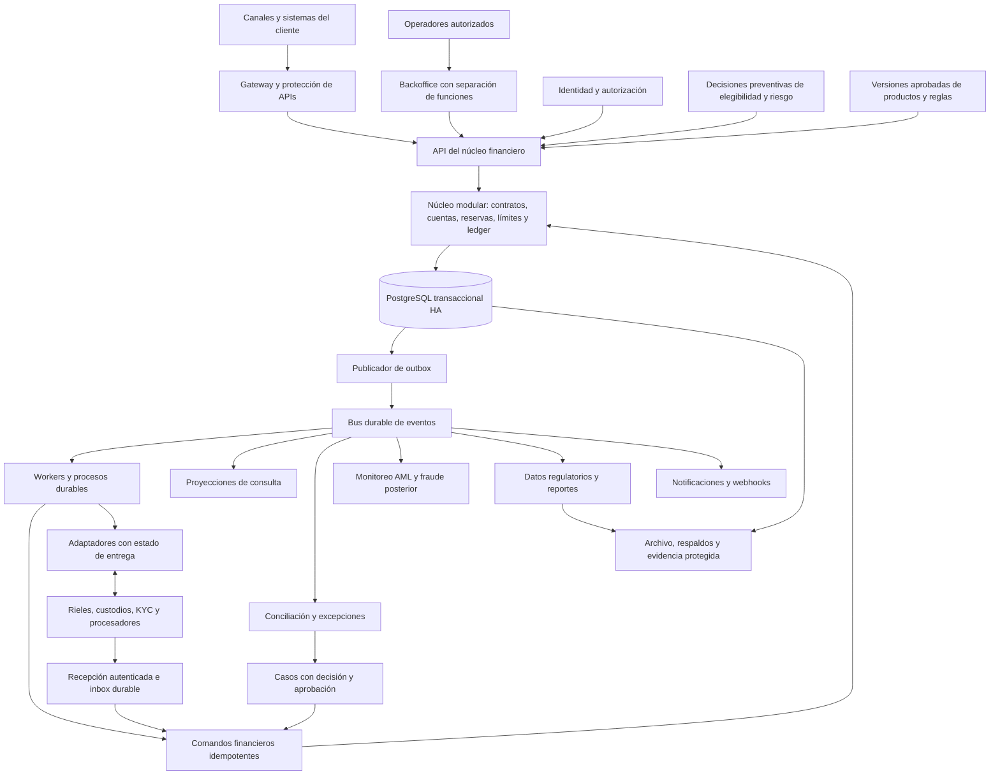
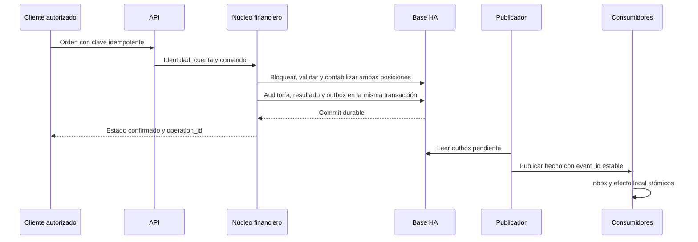
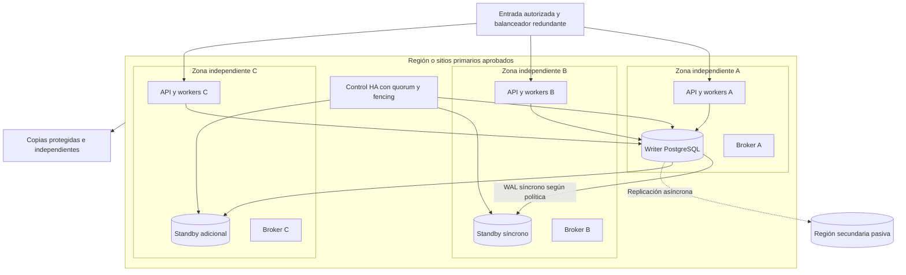
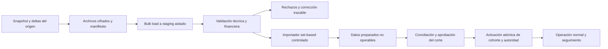

# Arquitectura modular del core bancario argentino

**Versión:** 1.0. **Fecha:** 15 de octubre de 2026, Argentina. **Estado:** diseño propuesto para implementación; las metas operativas requieren validación con pruebas y un cliente de diseño. Se conserva el nombre `achitecture.md` solicitado.

**Actualización de stack, 16/10/2026:** por decisión explícita del mantenedor, el lenguaje del dominio y los servicios pasa a **Rust** y las imágenes propias destinadas a Kubernetes tendrán una etapa final **`FROM scratch`**. La implementación y los ensayos siguen pendientes; se conserva el alcance financiero y el historial de ADR-07.

La propuesta toma como base [el análisis de mercado](market_analysis.md), [el relevamiento de cumplimiento](compliant.md) y [el skill del proyecto](../.agents/skills/core-bancario-argentina/SKILL.md). Los identificadores `LAW`, `AML`, `DATA`, `TAX`, `BCRA-F`, `BCRA-T`, `PAY`, `RPT`, `STD` y `CTL` remiten a esos documentos. Las elecciones de arquitectura son decisiones de ingeniería; no equivalen a una certificación normativa ni a una autorización para prestar servicios financieros.

## Navegación

- [Decisión y estrategia](#estrategia).
- [Módulos y despliegues](#modulos).
- [Consistencia y ejecución](#consistencia).
- [Procesamiento asíncrono](#asincronia).
- [Configuración](#configuracion).
- [Disponibilidad y recuperación](#disponibilidad).
- [Latencia y capacidad](#rendimiento).
- [Seguridad y datos](#seguridad).
- [Operación y entrega](#operacion).
- [Carga inicial masiva y migración](#carga-inicial).
- [Trazabilidad de estándares y controles](#cumplimiento).
- [Implementación y aceptación](#implementacion).

<a id="estrategia"></a>

## 1. Decisión arquitectónica y encaje comercial

Construir un **núcleo financiero modular con una única frontera transaccional por entidad**, acompañado por procesos asíncronos independientes. Separar los módulos por responsabilidad y contratos internos desde el inicio; desplegar por separado sólo los componentes que requieren aislamiento, escalado, conectividad o seguridad propios.

El primer producto comercial recomendado es administración de préstamos con contabilidad y conciliación para un prestamista o una cartera satélite. El ledger de cuentas de pago constituye un segundo perfil posible, que debe seleccionarse en lugar del primero si el cliente de diseño y el socio de pagos lo justifican. La plataforma comparte fundamentos, pero no presupone que ambos perfiles puedan implementarse simultáneamente con el mismo esfuerzo. Depósitos bancarios, tarjetas propias, cambios y tesorería universal se incorporan por módulos y habilitación regulatoria.

La ventaja buscada es lanzar un producto argentino delimitado y explicable hasta el asiento, reutilizar su localización entre clientes y reducir el costo de integración y operación. Se evitan forks por banco: configuración versionada, adaptadores y extensiones controladas cubren las variaciones. Una funcionalidad sólo se ofrece como disponible después de probarla en su producto y perímetro; un conector diseñado no se presenta como una integración homologada.

| Necesidad estratégica del análisis de mercado | Decisión de arquitectura | Cómo medir su valor |
|---|---|---|
| Entrada por préstamo, pagos o cartera acotada | Perfiles funcionales sobre un núcleo común; activación por sociedad/licencia | Tiempo y costo hasta un piloto aceptado de ese perfil |
| Localización argentina mantenible | Paquete regulatorio versionado con procedencia, pruebas y fecha efectiva | Tiempo de incorporar un cambio común sin bifurcar el producto |
| Convivencia con cores existentes | APIs, adaptadores y conciliación; una autoridad por contrato y saldo | Diferencias no explicadas y tiempo de migrar una cohorte |
| Evitar costos ocultos de composición | Responsabilidad explícita por módulo, operación e integración | Costo total por contrato operado y costo de soporte por cliente |
| Confianza y portabilidad | Evidencia exportable, datos documentados y salida ensayada | Reconstrucción de un saldo y restauración fuera del proveedor |
| Diferenciarse de una suite universal inmadura | Alcance inicial limitado y pruebas financieras profundas | Reutilización entre los primeros dos clientes y defectos materiales |

La elección de nube o de infraestructura propia queda subordinada a sitios independientes, latencia medida, residencia documental, contratos y acceso supervisor. El diseño no depende de un proveedor de core ni de una nube específica. No se extrapolan las métricas nacionales de pagos a un requisito de capacidad de cada cliente.

### Supuestos y límites de la propuesta

- No hay todavía una entidad operadora, licencia, equipo, volumen real o región elegidos. Los números de capacidad y recuperación de este documento son hipótesis explícitas de diseño.
- La configuración puede representar entidades financieras, PSP y prestamistas; sólo habilita las operaciones permitidas para cada sociedad. Una cuenta de pago no se convierte en depósito ni obtiene garantía bancaria.
- Cada celda contiene inicialmente una entidad jurídica y su frontera contable. Una celda es una unidad aislada de operación, datos y fallos; no es una partición de Kafka.
- El perfil inicial es minorista y acotado. No se incluyen en la primera entrega procesamiento propio de tarjetas/PIN, conectividad Swift, custodia de valores, negociación, monedas digitales ni agentes de IA que autoricen movimientos.
- Se soporta operación continua junto con cierres, devengamientos y reportes periódicos. Las tareas masivas se ejecutan sin suspender innecesariamente los canales.

<a id="modulos"></a>

## 2. Vista lógica



La flecha de la base al publicador representa lectura de una outbox persistida dentro de la transacción de negocio. No representa un segundo envío que deba tener éxito para confirmar el asiento. El bus distribuye hechos; sólo el núcleo acepta comandos que modifican dinero. Los controles preventivos de seguridad, elegibilidad y riesgo se ejecutan antes de autorizar, aunque el monitoreo posterior sea asíncrono.

## 3. Catálogo de módulos y propiedad de datos

| Módulo | Responsabilidad y datos propios | Frontera de consistencia / integración | Alcance inicial |
|---|---|---|---|
| Identidad y permisos | Usuarios, servicios, roles, delegaciones, factores y acceso privilegiado | Servicio especializado; autorización de cuenta/entidad y revocaciones efectivas comprobadas por el núcleo | Obligatorio |
| Personas y elegibilidad | Identificadores internos, representantes, facultades, estado KYC, beneficiarios finales y referencias a legajos | PII y documentos en almacén restringido; estado operativo y restricciones relevantes disponibles en la base del núcleo | Obligatorio según producto |
| Catálogo y configuración | Productos, monedas, calendarios, fórmulas soportadas, comisiones, impuestos y políticas por vigencia | Versiones aprobadas activadas atómicamente; sin consulta remota al plano de configuración por operación | Obligatorio |
| Contratos y cuentas | Titularidad, condiciones aceptadas, préstamos, cronogramas y estados de cuenta | Misma transacción que los asientos cuando cambia una obligación o posición financiera | Préstamos o cuentas según perfil |
| Disponibilidad y restricciones | Saldos utilizables, reservas, embargos, congelamientos, sobregiros habilitados y límites | Consistencia fuerte con ledger; ninguna caché es autoridad monetaria | Obligatorio |
| Exposición y autorizaciones | Límites de crédito, uso de línea y agregaciones preventivas por contraparte/grupo | Contadores/reservas de límite en la misma transacción; decisiones de riesgo externas vinculadas a su versión y vencimiento | Según producto/licencia |
| Ledger y contabilidad | Diario balanceado, auxiliares, mayor, cuentas puente y reglas de imputación | Escritor exclusivo; operación, reserva, asiento, auditoría y outbox en una única transacción local | Obligatorio |
| Intereses y ciclo de crédito | Devengamientos, cuotas, mora, pagos parciales, precancelación y refinanciación | Cálculo masivo asíncrono; aplicación por comando financiero idempotente y período | Préstamos; depósitos posteriores |
| Pagos y liquidación | Órdenes, intentos, referencias externas, autorización, estados y fondos en tránsito | Estado financiero en núcleo; adaptador aislado para comunicación con cada riel | Según perfil |
| KYC, AML/FT/FP y fraude | Verificaciones, listas, monitoreo, alertas, investigaciones y decisiones reservadas | Integración especializada; controles preventivos requeridos antes de ejecutar, eventos posteriores conciliados | Según sujeto y producto |
| Conciliación | Extractos, archivos, saldos, movimientos esperados/observados, diferencias y antigüedad | Base de trabajo separada; ajustes aprobados retornan como comandos al núcleo | Obligatorio |
| Localización y reportes | Mapeo BCRA, UIF, ARCA, COMARB y otros por licencia; cierres, archivos y validaciones | Lecturas desde cortes consistentes; presentación por responsable autorizado y seguimiento de aceptación | Regímenes del perfil |
| Contratación y atención | Plantillas, aceptación, comprobantes, reclamos, bajas e impugnaciones | Documentos versionados; acciones monetarias delegadas al núcleo; relojes normativos propios | Obligatorio según servicio |
| Evidencia y privacidad | Auditoría, acceso, retención por clase, solicitudes de titulares y preservación legal | Registro durable de acción y exportación protegida; permisos separados de operación | Obligatorio |
| Operación de plataforma | Salud, despliegues, capacidad, incidentes, recuperación y terceros | Plano operativo segregado con trazabilidad; no accede por defecto al contenido del cliente | Obligatorio |

Cada módulo expone una interfaz y controla su esquema/tablas. El núcleo puede compartir una base física para preservar transacciones locales; no se habilitan escrituras arbitrarias entre módulos. APIs, workers de intereses y adaptadores invocan la misma biblioteca de comandos y sus invariantes. Roles de base y procedimientos de contabilización limitan la escritura directa del diario. El publicador sólo lee outbox y actualiza su entrega; el reportero y los consumidores no tienen permiso para corregir saldos.

### Unidades de despliegue

Inicialmente se mantienen cinco grupos: **API/backoffice**, **núcleo y workers financieros**, **publicadores/adaptadores**, **workers de conciliación/reportes/notificaciones** y **servicios de identidad/seguridad**. El núcleo es un monolito modular en código; API y trabajadores pueden correr en procesos distintos usando las mismas reglas de dominio. Se separan pools, credenciales, recursos y escalado por función. Kafka, bases y archivo son servicios de plataforma gestionados cuando la jurisdicción y el contrato lo permitan.

Los módulos se extraen como servicios sólo ante una necesidad comprobada: aislamiento PCI, conectividad de un riel, perfil de carga distinto, independencia de entrega o reducción del impacto de fallos. No se divide reserva, límite y asiento en tres bases independientes para una misma autorización financiera.

<a id="consistencia"></a>

## 4. Qué responde inmediatamente y qué se demora

| Operación | Parte síncrona indispensable | Trabajo asíncrono permitido | Respuesta y semántica |
|---|---|---|---|
| Consultar saldo utilizable | Autenticar, autorizar y leer estado consistente del núcleo | Analítica y agregaciones no autorizantes | `200` con versión y fecha; un saldo de una proyección se etiqueta como informativo |
| Transferencia interna en la misma celda | Restricciones, fondos/límites, dos posiciones y asientos atómicos | Avisos, proyecciones y monitoreo posterior | Éxito sólo después del commit durable |
| Transferencia externa inmediata | Controles y respuesta exigidos por riel; reserva/contabilización y estado durable | Tareas posteriores que el esquema permita | Confirmación final sólo ante evidencia del estado externo; timeout no equivale a rechazo |
| Solicitud que admite demora | Validar formato, identidad, autorización y persistir solicitud | Evaluación/originación, firma, aprobaciones y ejecución posterior | `202`, `operation_id`, estado y URL de consulta; solicitud recibida no implica contrato activado |
| KYC y apertura | Recibir evidencia y consentimiento; impedir operar mientras falten condiciones requeridas | Verificación documental, investigación y validación humana | Apertura pendiente diferenciada de cuenta operativa |
| Desembolso de préstamo | Comprobar contrato, condiciones, decisiones vigentes, exposición y fondos; contabilizar | Preparación y validaciones costosas previas, notificación | No desembolsar basándose en una aprobación caducada o sin reservar el límite concurrente |
| Devengamiento/cierre | Comando individual atómico con versión/período | Particionado, cálculo, controles de completitud y generación documental | Trabajo con seguimiento; cerrar sólo con todos los lotes requeridos conciliados |
| Reporte, extracto histórico o exportación | Autorizar y persistir pedido/corte | Extracción, validación, firma/presentación y entrega | `202`; distinguir generado, presentado, aceptado y rechazado |
| Reclamo o solicitud de privacidad | Número, recepción y reloj durable | Investigación, respuesta y corrección autorizada | Acuse inmediato; no esperar al worker para iniciar el plazo legal |

La asincronía se elige por **semántica y plazo aplicables**, no sólo por preferencia técnica. Un canal inmediato no recibe un éxito ficticio mientras el trabajo espera una cola. Los controles de fondos, revocación de mandato, restricciones judiciales, congelamientos y verificaciones preventivas exigibles no se trasladan al monitoreo posterior.

Cada adaptador documenta tiempos, estados, causas admisibles de rechazo, procedimiento ante caída y responsable. En recepción de transferencias no se inventan demoras/rechazos por indisponibilidad interna del antifraude: el tratamiento se homologa con el esquema y PAY-05. Una política de contingencia puede limitar nuevas operaciones salientes o derivar una decisión cuando esté permitido; no habilita retener o rechazar indiscriminadamente fondos entrantes.

## 5. Invariantes del núcleo financiero

1. **Partida doble por entidad y moneda.** Débitos y créditos cuadran en cada operación. Una operación de cambio utiliza posiciones y cuentas puente por moneda con su cotización e imputación; no compensa números de distintas monedas para simular balance.
2. **Una autoridad monetaria.** Diario, posiciones y reservas están en la base transaccional del núcleo. Las proyecciones se pueden reconstruir; no autorizan gasto.
3. **Disponibilidad consistente.** Saldo contable, reservas y restricciones forman una definición explícita por producto. Reservar no se presenta como pago liquidado. Restricciones que prohíben operar prevalecen sobre el saldo.
4. **Exactitud.** Importes con decimal exacto y escala por moneda/concepto; mayor precisión intermedia para tasas e índices y redondeo aprobado al contabilizar. No se usa coma flotante binaria para dinero. Conservar unidades UVA/UVI, valores oficiales y fechas de conversión cuando se habiliten.
5. **Historia preservada.** Asientos contabilizados no se editan ni borran por un usuario de negocio. Correcciones mediante nuevos asientos vinculados, motivo y aprobación. El archivo conserva historia y evidencia según categoría, sin imponer retención infinita a todos los datos personales.
6. **Efecto financiero único.** Restricciones únicas por operación de negocio y referencia del riel complementan la idempotencia de transporte. Los reintentos no consumen dos veces fondos o límites.
7. **Temporalidad explícita.** Evento, recepción, contabilización, valor y período de negocio se almacenan por separado. Instantes en UTC; calendarios y fecha de negocio con zona `America/Argentina/Buenos_Aires` cuando corresponda. Un scheduler usa la zona y calendario de su producto.
8. **Condiciones históricas.** Cada contrato/cálculo conserva versiones de producto, tarifa, regla fiscal, índice y decisión utilizadas. Una actualización no reescribe contratos ni períodos cerrados.

### Transacción de referencia

```text
BEGIN
  verificar identidad/entidad, autorización y vigencia de decisiones
  reclamar clave idempotente y comparar hash canónico del comando
  bloquear posiciones, reservas, restricciones y límites en orden estable
  revalidar estado, versiones, disponibilidad y condiciones de ejecución
  actualizar contrato/orden/reserva/exposición, según el comando
  insertar operación y asientos balanceados; actualizar posiciones
  insertar auditoría de negocio y hechos en outbox
  persistir resultado estable asociado a la clave idempotente
COMMIT durable con confirmación de réplica síncrona
responder con operation_id y estado efectivamente alcanzado
```

Se propone aislamiento `READ COMMITTED` con bloqueos explícitos `SELECT ... FOR UPDATE` sobre todas las filas que protegen un invariante, tomadas en orden determinista. Se mantiene una **fila guardiana estable por cuenta y grupo/línea**: tanto autorizar un débito como crear/cambiar reservas, mandatos o restricciones bloquean esa misma fila antes de leer o modificar el estado. Bloquear sólo restricciones ya existentes no protege contra una inserción concurrente cuando todavía no hay ninguna. Las restricciones únicas y la validación de partida doble se hacen también en base de datos/procedimientos controlados. Predicados como «exposición total del grupo» se representan mediante una fila de control bloqueada y actualizada en la misma transacción, evitando sumar una vista atrasada. Un caso que no pueda modelarse así usa aislamiento serializable y reintenta abortos completos con la misma identidad de comando.

No se realizan llamadas de red dentro de la transacción que mantiene bloqueos monetarios. Las validaciones remotas se obtienen antes; el commit revalida la referencia, vigencia y estado local autorizado. Si se necesita una decisión nueva, se abandona la transacción y se vuelve a evaluar. Deadlocks y conflictos tienen reintentos acotados; no se transforma un reintento SQL en un nuevo envío al riel.

Si existen exposiciones o cuentas en otro core, el límite agregado no se obtiene de una suma eventual. La coexistencia requiere una autoridad compartida de límites o cupos previamente asignados a cada sistema, cuya suma no exceda el límite global; el núcleo consume su cupo local en la misma transacción. Reasignar/liberar cupos exige coordinación y confirmación, evitando disponibilidad doble entre sistemas. Sin esa solución se limita el producto/cohorte a un perímetro donde el control pueda demostrarse.

### Idempotencia de API

Clave compuesta por entidad, principal/cliente autorizado, tipo de operación y `Idempotency-Key`. Se guarda hash del contenido canónico, resultado y referencia de negocio. Mismo contenido devuelve el resultado previo autorizado; la misma clave con otro contenido se rechaza como conflicto. Un timeout HTTP no prueba rollback: el cliente consulta con la misma clave/identificador antes de intentar otra orden.

Las claves de transporte no se purgan antes del horizonte de reentrega y revisión definido. Además, las referencias materiales de negocio conservan unicidad durante la vida y conservación de la operación. Así, expirar una caché de idempotencia no permite repetir un desembolso histórico. Autorización y separación de entidades se verifican también al consultar una respuesta previa.

## 6. Flujos financieros de referencia

### Transferencia interna



Una transferencia entre celdas o entidades no utiliza esta garantía local. Se modela como dos operaciones vinculadas con cuentas puente, autorización y liquidación/conciliación explícitas, según el sistema de pagos correspondiente. No se ofrece atomicidad global implícita ni se elimina una diferencia entre sociedades compensando sus libros.

### Operación con riel externo

1. El núcleo registra orden, referencias y reserva o asiento previsto por el producto. La etapa requerida para responder al canal queda documentada por riel.
2. El adaptador registra durablemente la intención de envío con referencia estable y adquiere su derecho mediante transición condicional y época de operación vigentes. Una intención registrada se trata como potencialmente enviada si luego se pierde al worker, aunque no haya quedado respuesta.
3. Envía sin mantener una transacción SQL abierta. Si el riel soporta idempotencia, usa la referencia homologada. Un riel sin ese soporte requiere controles adicionales de consulta y conciliación.
4. Una respuesta o callback autenticado se guarda en inbox antes del acuse de recepción; luego un comando idempotente aplica la transición y los asientos correspondientes.
5. Ante timeout posterior al posible envío, la orden queda `UNKNOWN` o `PENDING_CONFIRMATION`; se consulta el estado externo y se concilia. No se reenvía ciegamente, no se confirma pago ni se libera automáticamente la reserva. Un lease/época local no puede impedir por sí solo que un worker rezagado llame a un tercero: si el riel no deduplica ni reconoce fencing, una recuperación no obtiene permiso de reenvío por el simple vencimiento del lease. Debe aislarse el proceso anterior y resolverse el intento potencial mediante consulta/conciliación y el procedimiento del riel.
6. Rechazo inequívoco libera la reserva mediante transición controlada; confirmación válida la convierte en los asientos previstos. Reverso o devolución posterior es un nuevo hecho financiero vinculado.

La expiración automática de una reserva sólo procede antes del envío o cuando exista evidencia de que no puede ejecutarse externamente. Para operaciones ambiguas se usa un caso con antigüedad, responsable y escalamiento; un TTL técnico no decide sobre fondos potencialmente liquidados.

<a id="asincronia"></a>

## 7. Asincronía durable y contratos de eventos

### Patrón base: outbox, inbox y efectos externos

El núcleo persiste hechos en outbox junto con la operación. Publicadores redundantes toman trabajo con reclamación durable y recuperable, publican y marcan entrega tras la confirmación del bus. Una caída entre publicar y marcar produce duplicados; los consumidores deben tolerarlos.

Cada consumidor inserta `(consumer_id, entity_id, event_id)` en su inbox y aplica su efecto local en la misma transacción de su propia base. Confirma el offset después del commit local. Para correo, webhook o un tercero, crea una **outbox de entrega del consumidor** y un intento durable; no afirma atomicidad entre SQL y una llamada de red. Ante duda consulta estado cuando exista esa capacidad y conserva el historial de intentos.

Se asume entrega **al menos una vez** y efectos financieros idempotentes. Las garantías de transacciones internas de Kafka no resuelven por sí solas el commit de PostgreSQL ni un pago externo. No se utiliza una transacción distribuida entre núcleo, bus y riel.

### Envelope de referencia

```json
{
  "specversion": "1.0",
  "id": "evt_01_example",
  "source": "/core/entity-example/payments",
  "type": "ar.bank.payment.confirmed.v1",
  "subject": "payment/pay_example",
  "time": "2026-10-15T18:00:00Z",
  "datacontenttype": "application/json",
  "dataschema": "urn:bank:schema:payment-confirmed:1",
  "entityid": "entity-example",
  "aggregateid": "pay_example",
  "aggregateversion": 7,
  "correlationid": "op_example",
  "causationid": "cmd_example",
  "data": {
    "payment_id": "pay_example",
    "ledger_operation_id": "jrn_example",
    "status": "CONFIRMED",
    "currency": "ARS",
    "amount": "1250.00",
    "product_version": "product-example-v3"
  }
}
```

El ejemplo usa estructura [CloudEvents](https://github.com/cloudevents/spec/blob/v1.0.2/cloudevents/spec.md) y valores ficticios. Los importes viajan como strings decimales con moneda y escala documentadas. Esquemas registrados, compatibilidad validada en CI y consumidores tolerantes a campos opcionales. Cambios semánticos incompatibles crean un nuevo tipo/versión y un período de convivencia. Firmas/autenticidad y permisos pertenecen al transporte y al contrato de integración; el formato por sí solo no autentica el evento.

### Orden, privacidad y replay

- Particionar por entidad y agregado de negocio. Cada agregado lleva secuencia monotónica asignada en la misma transacción; el publicador preserva su orden o el consumidor detecta huecos y espera/reconstruye antes de aplicar una proyección dependiente de ese orden.
- No se presupone orden global entre cuentas ni particiones. Una transferencia con dos cuentas se confirma en el núcleo y publica su operación; cada proyección usa una secuencia propia y consistente. Cambiar particionado requiere migración controlada.
- El bus general contiene los datos mínimos necesarios y referencias pseudónimas. AML recibe el conjunto completo autorizado mediante topic/API restringido y conciliado; notificaciones o analítica no heredan acceso a legajos, ROS o contrapartes sensibles.
- Replay reconstruye proyecciones mediante un consumidor/namespace específico. Por defecto inhibe efectos externos: no reenvía desembolsos, correos, ROS ni webhooks históricos. Las referencias del núcleo siguen impidiendo doble contabilización.
- Kafka es transporte y retención operativa, no libro mayor ni archivo legal único. Se conservan snapshots y hechos/documentos canónicos suficientes para reconstrucción, con períodos y permisos por clase.

## 8. Trabajos, reintentos y presión de carga

Los trabajos usan una máquina de estados durable: `READY`, `RUNNING`, `WAITING`, `SUCCEEDED`, `FAILED` o `MANUAL_REVIEW`, con intentos, próximo vencimiento, deadline, versión y responsable. El worker reclama trabajo mediante compare-and-set/lease con vencimiento y token que condiciona sus cambios locales. Reanudar tras caída recupera el estado persistido y vuelve a verificar la elegibilidad; no depende de memoria del proceso o de un cron local único. Recuperar un job no implica repetir un efecto externo potencialmente enviado: se aplica el procedimiento de ambigüedad de la sección 6.

| Clase | Política propuesta | Límite y manejo de excepciones |
|---|---|---|
| Error transitorio seguro | Backoff exponencial con jitter y máximo de intentos/tiempo por integración | Al agotarse, caso y alerta; no reintentar errores de autorización o formato sin corrección |
| Estado externo ambiguo | Consulta de estado y conciliación con misma referencia | Sin nuevo envío ciego; intervención si no existe resolución automática segura |
| Evento inválido o versión no soportada | Cuarentena/DLQ con datos protegidos y referencia al original | No se considera procesado funcionalmente; dueño, antigüedad y corrección trazables |
| Trabajo financiero con deadline | Prioridad, capacidad reservada y alerta por margen restante | Escalar antes del plazo; una DLQ no suspende una obligación ni un cómputo legal |
| Proyección prescindible temporalmente | Reintento y reconstrucción desde checkpoint | Mostrar fecha y retraso; no utilizar para autorizar |
| Notificación/webhook | Intentos firmados con identificador, expiración y entrega trazable | No exponer datos sensibles en URL/log; receptor deduplica; fallo no cambia el asiento |

Separar colas y pools para confirmaciones de pagos, fraude/AML, devengamientos, reportes y comunicaciones. La prioridad evita que un extracto masivo bloquee confirmaciones. Se limitan concurrencia por entidad, tamaño de lote, conexiones a base y tasa por tercero. Escalar workers según **edad de la tarea más antigua, plazo restante y tasa efectiva**, además de CPU y profundidad de cola.

Si el bus cae, la outbox permite seguir operaciones locales mientras exista capacidad segura y no se incumpla un control o plazo dependiente. Se monitorean espacio, crecimiento y antigüedad; antes de agotarse, se restringen las operaciones afectadas de forma documentada. No se borran eventos pendientes para liberar disco. Fallos de notificaciones no detienen el ledger; pérdida de capacidad para controles preventivos sí afecta las operaciones que los requieren, con tratamiento por riel.

Devengamientos base usan identidad económica única `(entity_id, contract_id, accrual_type, business_period)` y un manifiesto del universo esperado. La versión de regla es atributo de cálculo, no una forma de crear otro devengamiento del mismo período. Recalcular por cambio/corrección genera una comparación y ajustes idempotentes vinculados al original, con aprobación y contabilización permitidas. El checkpoint permite reanudar y el cierre exige completitud, conciliación y revisión de excepciones; la mera terminación de un worker no prueba cierre correcto.

<a id="configuracion"></a>

## 9. Configuración moderada y controlada

Configurar productos y reglas dentro de un catálogo de capacidades soportadas. Cambios en invariantes, algoritmos nuevos o relaciones contables nuevas requieren código, revisión y pruebas; no se incorpora un lenguaje de scripting arbitrario que ejecute SQL o llamadas externas en el camino financiero.

| Nivel | Configurable | Forma de cambio |
|---|---|---|
| Plataforma | Pools, cuotas, límites de payload, destinos y parámetros operativos | Configuración validada y secretos separados; despliegue/procedimiento trazable |
| Entidad | Perfil regulatorio, plan de cuentas, custodios, países permitidos y módulos habilitados | Resolución de alcance y versión aprobada por responsables competentes |
| Producto | Moneda, modalidad, cálculo soportado, calendario, tasas, comisiones, impuestos y mapeo contable | Borrador, simulación, revisión independiente, aprobación y vigencia |
| Cliente/contrato | Condiciones pactadas y excepciones permitidas | Dentro de facultades y límites; aceptación y evidencia de comunicación |
| Integración | Formatos, rutas, credenciales, timeouts, reintentos y homologaciones | Contrato de adaptador versionado y pruebas con contraparte |

No son desactivables mediante feature flags: partida doble, aislamiento de entidad, autorización, trazabilidad, integridad de auditoría ni controles legales aplicables. Habilitar un módulo no otorga licencia. Las flags permiten reducir exposición o habilitar una capacidad aprobada, sin saltarse sus controles.

### Registro de reglas

```yaml
rule_id: loan-interest-example
entity_id: entity-example
product_id: retail-loan-example
version: 3
status: approved
valid_from: "2026-11-01T00:00:00-03:00"
valid_to: null
recorded_at: "2026-10-15T15:00:00-03:00"
formula_id: supported-formula-reference
parameter_set_id: approved-parameters-reference
accounting_mapping_version: 2
source_reference: approved-contract-and-applicable-rule
approved_by: independent-approver-reference
change_reason: documented-change-reference
```

El ejemplo no fija una tasa ni una obligación real. `valid_from/valid_to` indican validez de negocio; `recorded_at` y el historial de revisiones indican cuándo el sistema conoció/aprobó la versión. Se impiden intervalos ambiguos y versiones no aprobadas; cada operación guarda el identificador exacto aplicado. El calendario de activación se valida también al ejecutar, de modo que la caída de un scheduler no active tarde una regla vencida ni autorice una futura antes de tiempo.

El plano de configuración publica paquetes firmados/con hash y el núcleo instala sus versiones en la base local. La activación cambia una referencia atómicamente y deja auditoría. Si el plano de administración cae, el núcleo continúa con versiones aprobadas válidas; nunca aplica silenciosamente una versión por defecto si falta la requerida.

Correcciones retroactivas se simulan, aprueban y aplican como ajustes explícitos con fecha contable permitida. Se preservan el cálculo original y su rectificación. Un rollback de configuración afecta decisiones futuras; no deshace pagos o contratos ya ejecutados.

<a id="disponibilidad"></a>

## 10. Alta disponibilidad, aislamiento de fallos y recuperación

### Topología por celda



Instancias de API y workers repartidas entre tres zonas/sitios realmente independientes, con capacidad ya disponible para perder una zona durante el pico aprobado. Readiness, drenaje, reinicio y despliegues preservan al menos la capacidad mínima. DNS, balanceadores, IAM, KMS, conectividad y monitoreo entran en el análisis de disponibilidad; no basta con replicar procesos de aplicación.

No todas las regiones/proveedores ofrecen tres zonas independientes. Si la ubicación aprobada sólo permite dominios de fallo dentro de un datacenter, no se declara tolerancia a pérdida del sitio por tener tres instancias. Se seleccionan sitios alternativos o un perfil híbrido y se vuelven a medir RTT, costo y recuperación.

### Base de datos y bus

PostgreSQL tiene un único writer por celda. `fsync=on`, `synchronous_commit=on` y una política efectiva de standby síncrono en otro dominio garantizan persistencia remota antes del éxito de la operación, bajo el modelo de fallo declarado. El servicio gestionado debe acreditar garantías equivalentes. La promoción elige una réplica que conserva los commits reconocidos y **aísla al writer anterior** antes de permitir tráfico. Un quorum de control distribuido y fencing verificable evitan dos primarios ante una partición. La distinción técnica entre replicación síncrona y pérdida posible con réplica asíncrona se apoya en la [documentación oficial de PostgreSQL](https://www.postgresql.org/docs/18/warm-standby.html); la topología y los objetivos aquí fijados son decisiones del proyecto.

Si no queda standby elegible, se detienen escrituras afectadas hasta recuperar la política; no se cambia silenciosamente a replicación asíncrona. Pérdida simultánea de todos los dominios que conservaron el commit queda fuera de la garantía local. Las lecturas autorizantes usan writer; una réplica sólo sirve una lectura que exige actualidad si prueba haber aplicado el punto requerido.

Kafka gestionado: tres zonas, factor de replicación 3, `acks=all`, `min.insync.replicas=2`, elección de líder no sincronizado deshabilitada y productor idempotente. Se supervisan ISR, disco, errores y edad de eventos. Su durabilidad no cambia la autoridad del ledger ni elimina la deduplicación de consumidores. Contrastar la configuración y el límite de las garantías transaccionales con el [diseño oficial de Kafka](https://kafka.apache.org/41/design/design/).

### Objetivos de recuperación propuestos

| Escenario | Meta de diseño inicial | Condiciones y límites |
|---|---|---|
| Caída de proceso | Redistribución ≤30 segundos; sin perder trabajo aceptado | Balanceador, base e identidad operativos; lease recuperable para workers |
| Pérdida de writer o una zona | RTO ≤120 segundos; RPO 0 de commits reconocidos bajo política síncrona | Standby elegible, fencing y capacidad remanente probados |
| Desastre regional | RTO ≤60 minutos en ensayo del perfil inicial | Región pasiva habilitada, llaves y dependencias recuperables; RPO real según último WAL durable recuperado |
| Corrupción o ransomware | RTO preliminar ≤4 horas para el volumen del piloto | Copia limpia, punto de recuperación identificado, claves disponibles y conciliación; reestimar con volumen real |

La región secundaria usa replicación asíncrona para contener latencia y costo. Se fija **lag operativo objetivo ≤60 segundos**, con alarmas y decisiones por crecimiento; esto **no es una garantía de RPO ≤60 segundos en toda catástrofe**. Un commit ya informado puede faltar en la región de recuperación. Antes de contratar se define si el perfil admite esa pérdida potencial y cómo reconstruir operaciones a partir de evidencia independiente. Si exige RPO regional cero, se modifica el diseño a persistencia/consenso síncrono entre sitios apropiados y se aceptan su RTT, costo y disponibilidad; la configuración pasiva asíncrona no satisface ese perfil.

### Copias y recuperación coherente

Mantener respaldos cifrados, recuperación puntual por WAL, copias protegidas frente al administrador productivo y copias fuera de línea según clasificación. BCRA-T19 exige al menos dos copias de las categorías indicadas; el inventario documenta independencia, localización y recuperación. Una réplica que propaga un borrado no sustituye un backup limpio. Probar también recuperación de claves, identidad, configuración, documentos, jobs e integraciones.

El runbook de desastre detiene entradas/egresos, aísla el primario anterior, identifica el punto autoritativo y compara operaciones, outbox, inbox, entregas y rieles. El broker puede contener eventos posteriores al punto SQL restaurado; una inbox restaurada puede ser anterior a sus offsets. No se reinician todos los consumidores con offsets arbitrarios. Se aíslan hechos huérfanos, reconstruyen manifiestos, consultan referencias externas y reparan con identidades originales antes de reabrir. Se reconstruyen proyecciones y se concilia el saldo, sin volver a enviar efectos externos históricos.

<a id="rendimiento"></a>

## 11. Baja latencia y capacidad verificable

### Perfil de prueba inicial

Se toma del modelo económico un universo **hipotético de 250.000 cuentas/contratos**. Los 36 millones de transacciones facturables/año de ese modelo equivalen a aproximadamente 1,14/s promedio, pero no definen comandos técnicos, asientos ni picos. Como hipótesis independiente de ensayo se proponen:

- 100 comandos monetarios/s sostenidos durante 60 minutos y pico de 500/s durante 10 minutos.
- Mezcla monetaria: mitad transferencias internas y mitad aceptación de pagos externos; ensayar aparte el flujo externo completo y sus callbacks.
- Hasta 1.000 lecturas/s concurrentes: mitad consistentes y mitad de proyecciones.
- Datos con cuentas concentradoras, historial, distribución de saldos, límites y cardinalidad representativos. Medir también un año de crecimiento y la ejecución simultánea de procesos obligatorios.

Son objetivos a validar con el cliente, no capacidad prometida de PostgreSQL, Rust o la infraestructura. Un comando puede producir múltiples asientos, mensajes e I/O; el presupuesto de infraestructura se deriva de esa amplificación medida.

| Trayecto medido desde el gateway hasta respuesta | Meta inicial p95 / p99 | Qué incluye |
|---|---|---|
| Saldo consistente | ≤50 / ≤100 ms | Autorización efectiva, consulta e instrumentación; infraestructura primaria saludable |
| Transferencia interna | ≤100 / ≤200 ms | Validación, contención representativa, transacción y confirmación síncrona durable |
| Aceptación de trabajo demorable | ≤75 / ≤150 ms | Validación, registro durable de solicitud y estado; no finalización del trabajo |
| Decisión que requiere un tercero | Presupuesto propio por riel/servicio | Se mide aparte latencia total y cumplimiento de su plazo; no se le aplica artificialmente el objetivo local |
| Publicación de outbox/proyección ordinaria | p99 de antigüedad ≤5 segundos en carga normal | Medición de frescura; los flujos con deadline menor tienen presupuesto independiente |

No incluyen la red pública del usuario; esa latencia se mide adicionalmente desde clientes sintéticos en ubicaciones reales. Los percentiles se calculan extremo a extremo, no sumando percentiles de componentes. Para una transferencia p99 de 200 ms se propone como presupuesto de ingeniería: 25 ms en gateway/identidad, 25 ms en dominio/reglas, 110 ms en locks/SQL/persistencia síncrona y 40 ms de margen/red interna. Es una asignación a ajustar mediante trazas, no un benchmark observado.

### Mecanismos de latencia y escalado

- Reglas y decisiones precomputables disponibles localmente con versión/frescura; validación efectiva de revocaciones y bloqueos materiales dentro del ámbito autoritativo. Un JWT de larga vida sin revocación no basta para privilegios sensibles.
- Transacciones cortas, índices por entidad/identificador/estado/fecha, pools limitados, sentencias preparadas y consultas sin N+1. Evitar reportes o escaneos de archivo en el writer.
- Caché sólo para catálogos aprobados y consultas tolerantes a atraso. Nunca para decidir fondos o levantar restricciones. Mostrar `as_of` y versión de vistas derivadas.
- Cuentas concentradoras con contención medida; subcuentas operativas y consolidación sólo si Finanzas aprueba su significado. No fragmentar el saldo de un titular para ocultar límites de concurrencia.
- Particionar tablas por necesidad medida de mantenimiento/archivo y tenant/celda; validar unicidad y referencias al particionar. No introducir sharding monetario en la primera entrega.
- Colas y conexiones reservadas para operaciones críticas; cuota por cliente y backpressure antes de agotar recursos. Autoscaling no corrige una fila caliente ni crea instantáneamente capacidad de base.

### Disponibilidad como servicio

Objetivo propuesto de **99,95 % mensual** de disponibilidad de API monetaria local, con medición por solicitudes válidas y canarios de operación. La equivalencia por tiempo en 30 días es **21 minutos y 36 segundos**; disponibilidad por solicitudes y por tiempo son indicadores distintos. Mantenimiento que impide operar consume el presupuesto. Un rechazo de negocio correcto no es indisponibilidad; timeout técnico, aceptación no durable o respuesta financiera incorrecta sí requieren tratarse como fallo del servicio/control correspondiente.

Desglosar por entidad y endpoint para no ocultar un cliente detenido en un promedio global. Pagos de extremo a extremo, frescura, integridad financiera y cumplimiento de deadlines tienen SLO separados que incluyen sus dependencias. Failover en 120 segundos no garantiza por sí solo la disponibilidad mensual. Alertar por consumo rápido/lento del presupuesto y limitar cambios riesgosos cuando se agota.

<a id="seguridad"></a>

## 12. Seguridad, multientidad y protección de datos

La celda inicial dedica base y credenciales a una entidad jurídica; claves y permisos de topics, archivos y soporte están separados. El plano de control comparte software y metadatos mínimos de operación. Una misma marca con banco, PSP y prestamista usa entidades/perfiles distintos y no mezcla fondos, contratos, impuestos ni reportes. Compartir infraestructura física en una etapa posterior requiere demostrar aislamiento y límites de recursos equivalentes; un filtro `entity_id` en la aplicación no es evidencia suficiente.

Acceso de usuarios mediante OIDC/OAuth y factores según riesgo, canal y obligación; identidades de servicio de corta duración, validación mutua o controles equivalentes de autenticidad, RBAC más autorización por entidad/cuenta/objeto/acción. Denegación por defecto y acceso privilegiado temporal, registrado y revisable. Separar crear/aprobar/liberar ajustes, reglas, importaciones y reportes. Mantener segregación entre desarrollo, producción y auditoría.

Las restricciones financieras, facultades y mandatos se actualizan mediante comandos transaccionales. Su acuse registra el punto en que la restricción quedó efectiva; el canal de recepción tiene SLA y escalamiento propios. No afirmar que una orden todavía no recibida ya se aplicó. Las listas y scores guardan procedencia, versión y frescura; su contingencia se decide por operación/riel, y el score no constituye la única base de decisión.

Cifrado en tránsito y reposo según clasificación; secretos en gestor dedicado, claves fuera de la base/backup que protegen y ciclo de rotación/revocación/recuperación probado. HSM se incorpora por riesgo y programa cuando corresponda; no se afirma obligatoriedad universal de un fabricante. KMS, IAM, certificados y red tienen dependencias recuperables en DR, sin exportar claves a destinos no autorizados.

Los datos personales residen en almacenes de acceso restringido y el ledger usa identificadores internos. El paquete probatorio conserva la relación autorizada entre identidad, contrato y operación durante su plazo. No se promete anonimización por sustituir un CUIT por un hash. Investigación y ROS están segregados de CRM, canales, analítica general y soporte ordinario. Pruebas, demos y prompts externos usan datos sintéticos salvo un fundamento explícito y controles aplicables.

Cada operación y cambio material persiste auditoría en el commit local; su exportación a almacenamiento resistente a alteración es asíncrona y monitorizada. Consultas/descargas sensibles también generan evidencia durable antes de completar la entrega. Se limita el acceso a trazas, se verifica su integridad y se conserva quién, qué, cuándo, canal, motivo, autorización y cambios relevantes. No registrar credenciales, factores ni información personal innecesaria en APM o logs.

La retención, residencia, derechos y avisos se detallan en la matriz de cumplimiento de este documento. El mapa de tratamiento incluye brokers, DLQ, backups, observabilidad y soporte desde otros países. La base primaria en Argentina no acredita por sí sola que todos esos flujos cumplan las condiciones de transferencia y archivo.

## 13. Datos, cierres y reportes asíncronos

Separar almacenamiento transaccional, proyecciones operativas, datos de conciliación, repositorio regulatorio y archivo. El diario sigue siendo la referencia financiera; los documentos de origen, reglas, estados contractuales e índices preservan el contexto necesario para reproducirlo.

Cada reporte genera un manifiesto: entidad, período/corte, conjunto de operaciones o snapshot consistente, watermarks por fuente/partición, versión de transformación, plan de cuentas, catálogos, parámetros, totales, excepciones y aprobadores. Un offset máximo de Kafka no representa por sí solo un corte global consistente: se requiere snapshot transaccional o barrera de completitud por todas las fuentes del conjunto.

Las transformaciones son reproducibles y conservan linaje de campo/importe hacia operación y asiento. El workflow distingue preparado, validado, aprobado, enviado, recibido, aceptado y rectificado. El ticket de subida no cierra la obligación si existen errores de validación. Cambios tardíos producen ajustes/rectificativas con historia, no reemplazos silenciosos del archivo aprobado.

El corte de negocio se desacopla del horario de recepción. Los contratos que operan 24/7 continúan según sus reglas; movimientos tardíos se imputan con la fecha permitida y revisión cuando corresponde. Reapertura de período y ajuste manual necesitan facultades, motivo y conciliación. Riesgos/Finanzas definen deterioro, inflación y agregaciones prudenciales aplicables; una proyección técnica no sustituye esa política.

Los regímenes UIF/ARCA/COMARB, los formatos de rieles y las reglas NIIF/BCRA pertenecen a paquetes por entidad y período. No se presenta todo el catálogo a un PSP por ser más cómodo; se seleccionan obligaciones y diseños efectivos de registro.

## 14. Plataforma tecnológica y decisiones registradas

| Componente | Propuesta inicial | Razón y criterio de sustitución |
|---|---|---|
| Dominio y servicios | Rust estable con toolchain fijado, módulos/crates e interfaces explícitas; HTTP/JSON y OpenAPI | Tipos monetarios exactos, manejo explícito de errores y concurrencia; runtime asíncrono y crates se evalúan por soporte, licencia, compatibilidad y mediciones |
| Autoridad financiera | PostgreSQL 18 soportado por el proveedor elegido; acceso con driver/pool y migraciones versionadas | Transacciones, restricciones y recuperación; ningún cambio de motor se considera equivalente sin pruebas de invariantes y durabilidad |
| Eventos | Kafka gestionado con esquemas versionados y envelope CloudEvents | Consumidores independientes, replay y orden por partición; dimensionar costo mínimo y cuota por celda |
| Procesos durables | Workers y tablas de jobs/estado con leases y checkpoints | Menor número de motores para el alcance inicial; adoptar un orquestador especializado sólo si procesos largos/compensaciones justifican su costo operativo |
| Archivo y evidencia | Almacenamiento de objetos cifrado con controles de integridad, retención y acceso | Documentos, respaldos, manifiestos y salida; bloqueo de objetos sólo por clase/plazo autorizado |
| Ejecución | Imágenes propias con build multietapa y runtime mínimo `FROM scratch`, binario Rust estático, usuario no root y payload de runtime explícito | Kubernetes gestionado multizona con probes sin shell, cuotas y apagado seguro; una plataforma equivalente debe preservar el mismo contrato de imagen y los requisitos |
| Identidad y claves | Proveedor IAM/SSO y gestor de secretos/KMS con soporte y recuperación | Construir sólo autorización de negocio propia; no crear un proveedor de identidad o criptografía casera |
| Observabilidad | OpenTelemetry más métricas, logs y trazas con acceso/retención definidos | Correlación de operación y dependencia sin capturar datos sensibles por defecto |
| Proyecciones y reportes | PostgreSQL separado/réplicas aptas para lectura y archivo columnar cuando se necesite | No imponer un data warehouse ni un buscador adicional hasta medir necesidad y costos |

No se prescribe Redis como condición de baja latencia ni se usa como saldo. Cada dependencia tiene versión exacta, licencia, SBOM, soporte, responsable, parcheo y procedimiento de salida. Las versiones concretas se congelan al implementar; no se despliega una RC o una imagen `latest` por estar recién publicada.

Fijar `rust-toolchain.toml`, `Cargo.lock`, features y target por arquitectura. Compilar código propio para Linux con enlace estático comprobado, preferentemente mediante targets musl soportados; verificar también dependencias nativas/FFI. Un binario Rust no es estático por defecto. Mantener cálculos monetarios exactos con redondeo y overflow controlados, y ejecutar CPU/I/O bloqueante fuera del executor asíncrono con concurrencia acotada. La seguridad de memoria no demuestra integridad financiera ni ausencia de deadlocks o doble efecto externo.

En este proyecto, **distroless** significa una etapa final `FROM scratch` con payload explícito: binario, confianza TLS pública y datos de zonas horarias necesarios, incorporados o montados según contrato. Sin shell, gestor de paquetes, compilador, herramientas de desarrollo, credenciales o claves privadas dentro de la imagen. Probes HTTP/TCP/gRPC compatibles con el servicio y manejo de SIGTERM no requieren shell. El [contrato Rust/scratch](deployment/rust-scratch.md) define construcción, endurecimiento, apagado, evidencia y aceptación por arquitectura. El requisito aplica a imágenes propias del API, workers y jobs; los servicios de terceros mantienen sus artefactos y evaluación de soporte/seguridad correspondiente.

Los [Architectural Decision Records](adr/README.md) formalizan estas decisiones: **ADR-01** núcleo modular; **ADR-02** autoridad SQL y escritor único; **ADR-03** outbox/inbox; **ADR-04** activo/pasivo regional; **ADR-05** configuración limitada y versionada; **ADR-06** aislamiento por celda; **ADR-07** stack y mensajería gestionados; **ADR-08** carga inicial por staging y publicación controlada. Su estado inicial es Propuesto, con implementación sin evaluar. Cambiar una decisión exige documentar alternativa, riesgo, costo y evidencia. Sus [skills](skills.md) permiten crear, mantener, aplicar o revisar los registros según el trabajo solicitado.

<a id="operacion"></a>

## 15. Operación, entrega segura y costos

Instrumentar latencia p50/p95/p99, errores, duración/espera de locks, saturación de pools, WAL/replicación, espacio de outbox, edad de jobs, lag de consumidor, confirmaciones ambiguas, conciliación por antigüedad, plazos AML/reportes, frescura de reglas y tiempo de restauración. Correlación desde solicitud hasta asiento, evento, adaptador y evidencia, con identificadores que no revelen datos personales.

Guardia y runbooks para falta de quorum, caída de riel, retraso normativo, posible doble envío, diferencia contable, claves comprometidas y recuperación. Un incidente de tercero se vincula a su impacto propio. Los temporizadores regulatorios y contractuales comienzan en su hecho disparador, no cuando alguien abre un ticket. La comunicación externa la realiza el responsable autorizado; la plataforma prepara formato, hitos y evidencia.

CI/CD incluye compilación reproducible, pruebas financieras/de contratos, análisis de dependencias/secretos/código, controles de infraestructura y validación de esquemas/configuración. Artefactos identificados y verificables, permisos de despliegue separados, revisión independiente de cambios materiales y promoción por entornos. Pruebas de vulnerabilidad externas e independencia de auditoría se planifican por alcance BCRA/contrato; un pipeline no las reemplaza.

Migraciones de esquema con expandir–migrar–contraer, compatibilidad entre versiones y despliegue gradual. El canary monetario sólo enruta cada contrato a una autoridad; un modo sombra no envía fondos ni duplica cargos. Rollback de software no elimina operaciones ya liquidadas ni autoriza restaurar una base anterior sin reconciliación.

El costo por celda incluye base y réplicas, bus, almacenamiento/WAL, retención, egreso, claves, observabilidad, entornos, guardia, pruebas, localización, homologaciones y salida. Medir costo por contrato/cuenta operada y por millón de comandos con su amplificación real. Compartir el producto y la automatización entre clientes; mantener explícito qué costo corresponde a integración específica. Servicios gestionados y pocos despliegues iniciales reducen la carga del proveedor entrante; una promesa de microservicios no justifica gasto por sí sola.

<a id="carga-inicial"></a>

## 16. Carga inicial masiva: bulk insert, staging y puesta en servicio

La implementación incorpora un **módulo de importación/migración masiva**, separado del API monetario ordinario. Se recomienda `COPY FROM STDIN` de PostgreSQL —o mecanismo equivalente del proveedor que preserve controles— para cargar staging, seguido por validación y aplicación por conjuntos. No se exige crear cada fila mediante miles de llamadas HTTP, ni se permite insertar directamente en tablas de saldos productivos sin la frontera de importación. La elección se apoya en la [interfaz COPY](https://www.postgresql.org/docs/18/sql-copy.html) y la [guía oficial de carga de datos](https://www.postgresql.org/docs/18/populate.html); el flujo de validación/publicación es un diseño propio de este core.



### 16.1 Contrato de importación

Cada corrida tiene `import_run_id`, entidad/perfil, cohorte, snapshot/fecha de corte, versión de esquema y mapeo, origen, responsable, modo de historia, hashes de archivos/chunks, conteos y totales por producto/moneda, secuencia de deltas y punto de control del origen. Archivos cifrados, almacenados en destino autorizado y escaneados/validados; no aceptar SQL ejecutable del cliente.

La API administrativa devuelve `202` con identificador y progreso de una corrida durable. El estado distingue `RECEIVED`, `STAGED`, `VALIDATING`, `REJECTED`, `READY`, `APPLYING`, `RECONCILING`, `APPROVED`, `ACTIVE` y `ABORTED`. Los rechazos conservan código, fuente, clave y motivo con acceso restringido. El reloj y progreso muestran filas leídas, aceptadas, rechazadas, pendientes y aplicadas, además de totales financieros.

Reanudar una corrida usa el mismo manifiesto y checksums. Cambiar un archivo, mapeo o dato ya validado crea una revisión/corrida vinculada e invalida la aprobación previa; no se reutiliza silenciosamente un checkpoint para contenido distinto.

### 16.2 Camino de datos y desempeño

1. **Preparar.** Extraer snapshot consistente y registros documentales. Normalizar encoding, separadores, timezone, identificadores, escala decimal y tratamiento de nulos. Enumerar población esperada; deduplicar con claves del origen, sin fusionar personas por similitud sin decisión.
2. **Cargar staging.** `COPY FROM STDIN` con columnas explícitas sobre tablas logged en una base/esquema de migración aislado por entidad y corrida. Staging conserva datos fuente y mapeos. Rol de importación limitado; nada de `COPY PROGRAM`, acceso arbitrario al filesystem del servidor o credenciales de superusuario.
3. **Validar.** Claves, relaciones, titularidad/facultades, monedas, estado KYC/bloqueos, garantías, principal/intereses/mora, cronogramas, fechas, índices, códigos y reglas de mapeo. Comparar conteos y sumas por titular/producto/moneda; un total general correcto puede ocultar cuentas intercambiadas.
4. **Aplicar por conjuntos.** Un importador privilegiado y auditado transforma lotes completos mediante SQL parametrizado/procedimientos o comandos bulk del dominio. Comparte reglas e invariantes con operaciones normales y valida la contabilización agregada e individual; no hace una llamada remota por fila. Importación de maestros precede a contratos, posiciones y dependencias.
5. **Conciliar y publicar.** Confrontar auxiliares/mayor, cartera, cuentas puente, reservas, restricciones y evidencia de origen. Los datos quedan en generación/cohorte no operable hasta completar condiciones. La publicación habilita la generación y el enrutamiento de autoridad mediante un cambio pequeño, transaccional y auditado.

Las tablas de staging no exponen endpoints de negocio. Si se usa RLS en un staging compartido, se elige una ruta compatible mediante inserciones autorizadas en lugar de desactivar la política para hacer `COPY`; la opción inicial es aislamiento dedicado con ACL. Se preservan las restricciones necesarias en el destino. Índices secundarios y tamaño de lote se optimizan con ensayo; los índices únicos y controles financieros del destino no se omiten para alcanzar throughput.

Usar chunks de tamaño configurable por bytes/filas y duración, commits por lote y checkpoints `(run, chunk, source_key)`. Un lote se confirma completo o se revierte; repetición verifica su checksum y no duplica posiciones/asientos. `ON CONFLICT DO NOTHING` no sustituye comparar el contenido y explicar cada diferencia. No usar descarte silencioso de filas inválidas en una carga financiera: la corrida no queda aceptada porque el mecanismo bulk terminó.

La aplicación de historia/deltas respeta la transacción económica completa del origen, con todas sus filas y asientos, aunque la extracción o staging use chunks diferentes. El checkpoint autoritativo avanza sólo tras aplicar esa unidad completa; ante un delta incompleto se espera o rechaza el conjunto con diagnóstico, sin publicar media transferencia.

La unicidad de los datos migrados también se controla entre corridas: `(entity_id, source_system, source_record_id, record_type)` identifica el objeto económico y su mapeo al destino. El número de corrida o su revisión no permiten volver a contabilizarlo. Una cohorte ya activa no acepta una segunda carga de apertura; cambios posteriores se procesan como deltas/correcciones controlados.

La capacidad se estima como `ventana = extracción + transferencia + carga + validación + aplicación + conciliación + corte + margen`, con paralelismo sólo donde no rompa dependencias. Medir filas/s **y operaciones financieras validadas/s**, crecimiento de WAL, replica lag, CPU/I/O, locks, memoria, tiempo de índices y recuperación. Ajustar throttle para preservar HA y el SLO de carteras ya activas. No desactivar WAL, `fsync`, persistencia síncrona, auditoría ni controles críticos para presentar un mejor benchmark.

### 16.3 Saldos iniciales e historia: elegir un modo explícito

| Modo | Qué se incorpora | Regla para evitar doble contabilización |
|---|---|---|
| Apertura conciliada | Contratos y estado vigente, principal/devengados/mora y saldos iniciales, con asientos de apertura balanceados y evidencia del origen | La historia previa se conserva en archivo consultable/legado autorizado; no se recontabiliza encima de la apertura |
| Historia financiera completa | Operaciones/asientos históricos con referencias, fechas, versiones, documentos y metadatos de migración | Se reconstruye y verifica la posición al corte desde esa historia; no se agregan además los mismos saldos como apertura |

Finanzas define el modo por cartera, política de fecha contable, cuenta técnica de migración y tratamiento de diferencias. Una cuenta técnica no oculta una diferencia inexplicada: la conciliación exige su importe y justificación aprobados. El paquete preserva búsqueda histórica para usuario, supervisor, UIF y fiscalidad según alcance, aun cuando el archivo previo no sea el ledger activo.

### 16.4 Snapshot, deltas y corte

En carga inicial sin operación concurrente se carga y valida antes de habilitar cuentas. Si el origen sigue operando, se necesita snapshot más deltas ordenados mediante CDC o un mecanismo de exportación controlado, con punto de corte verificable. No basta con extraer la misma tabla dos veces y suponer que no hubo movimientos intermedios.

Por cohorte, detener o enrutar de forma controlada nuevas órdenes al origen, drenar o identificar operaciones en vuelo, aplicar deltas hasta el último watermark, conciliar y transferir autoridad con una nueva época de enrutamiento. Cada contrato tiene **un solo sistema autorizado para modificarlo**. Si no existe una barrera verificable de corte, se requiere una ventana de suspensión de esa cohorte; no se promete migración sin interrupciones por usar CDC.

La generación preparada está excluida de las consultas/autorizaciones normales por estado y routing; los workers también verifican la generación activa. Activar la cohorte exige todos sus chunks completos y evidencia aprobada. Evita una transacción de millones de filas para el cambio final y evita que los primeros lotes queden operables mientras falta el resto.

Los libros, posiciones y eventos de preparación están aislados del mayor operativo, RI, conciliación ordinaria y publicaciones de hechos financieros corrientes. Sus totales se validan como paquete de migración separado. El enrutamiento/vistas autorizadas sólo incorporan la generación tras activación y el corte aprobado, sin sumar simultáneamente esos mismos fondos desde el origen; esto incluye reportes consolidados de coexistencia. Antes de pasar a activo se comprueba la integridad de esa frontera con consultas y consumidores de cada módulo.

### 16.5 Efectos históricos, reanudación y vuelta atrás

El modo de importación no envía pagos, notificaciones, cobros, webhooks o reportes ROS históricos como si fueran operaciones nuevas. Genera auditoría de cada lote/mapeo y un hecho explícito de publicación con manifiesto, además de los datos necesarios para construir proyecciones. La monitorización AML y las tareas futuras se habilitan conforme el plan de transición del sujeto; no se salta debida diligencia por haber usado bulk. Las próximas cuotas/devengamientos se programan desde el estado migrado sin repetir períodos ya aplicados.

Antes de activación se puede abortar una generación no operable y volver al origen, conservando la evidencia y tratando los datos por su política de retención. **Después de activar y admitir operaciones**, volver requiere reconciliar y trasladar operaciones nuevas mediante un plan de retorno o correcciones hacia adelante; no alcanza con borrar los lotes o restaurar un backup anterior. Egresos liquidados no se revierten por restauración de base.

Ensayar al menos: archivo duplicado, chunk repetido, checksum cambiado, corte de proceso en cada etapa, registro inválido, historia frente a apertura, saldos por titular, operaciones en vuelo, deltas tardíos o transacción fuente de varias filas, réplica atrasada, activación incompleta denegada, exclusión de la preparación del mayor/RI/eventos y retorno. Probar además transferencias entre una cohorte ya migrada y otra todavía en el legado, con cuentas puente y una sola autoridad por lado. Conservar manifiesto, datos de prueba, resultados y aprobación de Negocio/Operaciones/Finanzas/Seguridad/Cumplimiento según su responsabilidad. Esto implementa CTL-20 junto con CTL-01 a CTL-06, CTL-11, CTL-12, CTL-13 y CTL-19.

<a id="implementacion"></a>

## 17. Secuencia de implementación y aceptación

Los [Non-Functional Requirements](nfr/README.md) formalizan las cualidades y restricciones verificables de este diseño. Cada criterio identifica alcance, escenario, métrica/unidad, ventana, objetivo y evidencia; se relaciona con los ADR que contribuyen a satisfacerlo. Los objetivos permanecen propuestos y sin medición operativa acreditada.

| Etapa | Entregable | Condición para avanzar |
|---|---|---|
| Encuadre | Cliente/segmento, perfil, flujos de fondos, productos, BIA, fuentes, rieles y TCO | Alcance viable y responsables; ninguna dependencia regulatoria crítica sin plan concreto |
| Fundamentos | Núcleo, configuración, identidad, ledger, idempotencia, auditoría y outbox/inbox | Invariantes y concurrencia verificadas con escenarios monetarios aprobados |
| Producto acotado | Préstamos o cuentas/pagos, conciliación, integración AML/fraude y reportes del perfil | Circuito de extremo a extremo y obligaciones del alcance demostrables |
| Operación y carga | MultiAZ, recuperación, guardia, importador bulk y ensayos de corte | RTO/RPO observados, cartera reconciliada, cero diferencias inexplicadas y evidencias de migración |
| Primera operación | Cohorte limitada con límites de exposición y soporte acordados | Conciliación, cierres, reportes y atención estables; ampliar por evidencia |
| Repetibilidad | Segundo cliente sobre el mismo producto/configuración base | Menor trabajo específico sin forks; costo de soporte y capacidad financiera sostenibles |

Las ventanas ilustrativas del análisis de mercado se conservan como planificación, no como compromisos de esta arquitectura. Cada componente del piloto ya debe respetar seguridad e integridad del alcance; no se posponen como una fase final de endurecimiento.

### Ensayos de aceptación material

| Prueba | Resultado exigido |
|---|---|
| Débitos concurrentes, reservas y límite de grupo | Sin gasto/exposición duplicados ni sobregiro no autorizado; aislamiento y contención medidos |
| Cambio de facultad/bloqueo/mandato durante comando | Decisión consistente en su punto de serialización y recepción trazable |
| Commit con respuesta perdida, payload cambiado y reintento tardío | Un efecto, conflicto explícito para contenido distinto y unicidad histórica preservada |
| Caída en DB/outbox/publicación/inbox/ACK | Sin pérdida silenciosa ni efecto repetido; operación y consumo reconciliables |
| Pago externo incierto y callback tardío/duplicado | Sin reenvío o liberación indebidos; transición válida y conciliación |
| Broker/worker caído y backlog cerca de capacidad | Cola durable, alarmas, backpressure y recuperación dentro de presupuestos de cada flujo |
| Cierre, redondeos, índices ausentes y eventos tardíos | Cálculo reproducible, período correcto, excepciones y reporte conciliados |
| Carga normal, pico, cuenta caliente y pérdida de zona | Percentiles, errores y disponibilidad observados con controles activos y capacidad remanente |
| Partición y failover regional | Un solo writer, RTO/RPO medidos y reconciliación de DB/broker/rieles antes de reabrir |
| Restauración limpia y claves | Datos, documentos, jobs, identidad, secretos y contexto normativo recuperables; no sólo proceso levantado |
| Aislamiento, privacidad y acceso supervisor | Acceso cruzado denegado, soporte mínimo, derechos/retención correctos y exportación probatoria |
| Importación y transición | Todos los casos de sección 16, apertura/historia no duplicadas, baseline/deltas completos y retorno controlado |
| Salida de proveedor | Exportar y reconstruir contratos, diario, reglas, documentos, evidencia y saldos fuera de la plataforma |

Las pruebas dejan versión de software, infraestructura/configuración/reglas, escenario sintético, resultado esperado/observado, métricas/trazas/conciliaciones y responsable. Este documento define qué demostrar; no afirma que esas pruebas hayan sido ejecutadas sobre una implementación aún inexistente.

<a id="cumplimiento"></a>

## 18. Trazabilidad de leyes, regulaciones, estándares y controles

La matriz siguiente relaciona el diseño con las **173 entradas** del relevamiento y los **21 controles** del skill. Su estado es **diseñado; implementación y efectividad sin evaluar**. Las funciones condicionadas permanecen deshabilitadas hasta resolver su activador y evidencia. Cada implementación debe completar la aplicabilidad y las pruebas; la cobertura documental no equivale a cumplimiento demostrado. Las ediciones y fuentes normativas son las de [compliant.md](compliant.md), sin una nueva declaración de certificación ni revisión jurídica.

### Perímetro, exigibilidad y configuración normativa

La unidad de aislamiento y configuración es `deployment_cell → legal_entity → regulated_role → product_version`, con razón social/CUIT, autorización/registro, grupo BCRA, custodio, monedas, países de tratamiento y subcontratistas. Un despliegue puede compartir producto de software, pero no habilita por sí mismo licencias ni transfiere obligaciones entre sociedades. El perfil institucional es obligatorio antes de habilitar productos:

| Perfil | Activación y prioridad |
|---|---|
| EF autorizada | Catálogo según clase de entidad; depósitos/crédito/contabilidad/RI y prudencia por alcance; TI/SI, RRCI, UIF sectorial y SFD si hay canales digitales. P0: autorización, fondos, integridad, secreto, controles preventivos y evidencia regulatoria. |
| PSPCP | Cuenta de pago en pesos; saldo individualizado y disponible, respaldo bancario local del 100 %, separación de fondos operativos e inversión FCI sólo solicitada y diferenciada. TI/SI y RRCI vigentes, UIF sectorial según actividad y RI propios. Depósitos bancarios y garantía de depósitos quedan deshabilitados. |
| Otra función PSP | Se activa únicamente la función registrada/autorizada y sus reportes. TI/SI/RRCI según sujeto; SFD según servicio. No hereda todos los productos y ratios de una EF ni la condición PSPCP. |
| PNFC | Préstamos/cobranza y reportes/usuario según alcance. Fondos propios o contratos de fondeo; no captación de depósitos. UIF sólo si su actividad la incluye en el régimen pertinente. |
| PSCPP | Relaciones inversor–tomador y separación patrimonial; no asumir/garantizar riesgo ni prometer devolución. Registro y reglas específicas. |
| Proveedor tecnológico | Contrato, tratamiento, secreto, terceros, acceso supervisor, continuidad, evidencias y salida. No se presenta como entidad autorizada por vender el core. |
| Tarjetas, valores, cambios, tesorería mayorista, activos virtuales, contratación pública | Extensiones deshabilitadas hasta cerrar autorización, alcance, normativa sectorial, contratos, homologaciones y evidencia especializada. |

Cada requisito persistirá con `requirement_id`, fuente/sección/hash, edición, sujeto/actividad, clase, aplicabilidad con fundamento, publicación, vigencia/exigibilidad y disparador, dueño institucional, control, componente, prueba/evidencia, brecha y próxima revisión. Cada regla ejecutable agrega `effective_from/to`, `business_date_basis`, entidad/producto/moneda/jurisdicción, esquema, versión, aprobadores y firma del paquete. La configuración válida se compila y distribuye localmente al camino transaccional; ninguna consulta a un regulador, catálogo remoto o workflow administrativo debe quedar en la ruta de cada débito.

Una actualización modifica operaciones futuras conforme su vigencia; no reescribe contratos, asientos o reportes históricos. Los cambios que impliquen requisitos faltantes bloquean la activación del producto o la versión concreta, con diagnóstico visible al operador autorizado. Los interruptores de producto no permiten deshabilitar obligaciones materiales de un perfil.

### Frontera sincrónica y asincronía admisible

Deben decidirse antes del efecto financiero: autorización por entidad/cuenta/acción, facultades del titular, licencia/producto habilitado, consentimiento/mandato vigente, fondos/límites/reservas/congelamientos, idempotencia y controles preventivos requeridos para la operación. La decisión y su versión quedan asociadas al asiento. Un proveedor externo que no responda produce un estado explícito y la conducta permitida por el riel/producto; no transforma un acuse técnico en pago ni permite un rechazo genérico cuando no está admitido.

AML de monitoreo, agregación prudencial, conciliación, reportes, documentos y notificaciones se desacoplan cuando sus plazos lo permiten. Los congelamientos y restricciones que deban impedir ejecución se materializan mediante comando idempotente y transacción fuerte en el mismo núcleo que autoriza fondos. El bus no es la autoridad única sobre una prohibición vigente. Una alerta posterior puede originar investigación o ajuste autorizado; no borra un pago liquidado.

Las listas/score locales deben guardar procedencia, versión, fecha de recepción y política de frescura. La continuidad ante su indisponibilidad requiere una política por riel y tipo de operación aprobada conforme obligaciones preventivas, reglas de recepción y riesgo: un `fail-open` o `fail-closed` global no expresa esas diferencias. El score A8473 no puede ser la única base de decisión.

### Trazabilidad por familias legales y regulatorias

Los ID se remiten a las filas y fuentes de `compliant.md`. `P0` significa requisito de salida del alcance que corresponda; `P1`, operación y evidencia recurrentes; `C`, activación condicional. Esta prioridad de ingeniería no cambia la jerarquía jurídica. La tabla representa cobertura de diseño, no evaluación artículo por artículo ni certificación.

| Fuentes internas | Decisión de arquitectura / responsable | Evidencia y prioridad |
|---|---|---|
| LAW-01, LAW-04; BCRA-F01; BCRA-T01 | Perfil de entidad y catálogo de productos/licencias con habilitación efectiva; Legal/Cumplimiento aprueban encuadre. | Prueba negativa PSP→depósito/PNFC→captación y matriz institucional firmada; P0. |
| LAW-02, LAW-05; BCRA-F18; BCRA-T21 | Diario fuerte de doble partida, entidad/moneda, contrapartida, submayor/mayor y reglas NIIF adoptadas por BCRA. Política contable define mapeos, medición, deterioro e inflación. | Concurrencia, invariantes, cierre y cuadre contable; autorización del soporte legal electrónico cuando corresponda; P0. |
| LAW-03, LAW-11 | Control de consultas/exportaciones y requerimientos, finalidad, destinatario, mínimo privilegio y cadena de custodia; Seguridad/Legal. | Reconstrucción de accesos y entrega judicial/supervisora autorizada; P0. |
| LAW-06, LAW-07, LAW-08, LAW-10, LAW-12; BCRA-F02, BCRA-F03, BCRA-F07, BCRA-F08, BCRA-F09 | Catálogo contractual versionado; titularidad/poderes, ahorro sin saldo deudor, CFT/cargos coherentes, consentimiento, firma según su clase, documentos accesibles y reclamos. | Contrato→cálculo→asiento→extracto; revocación/baja/reintegro y plazos; accesibilidad según operador/contrato; P0/C. |
| LAW-09; PAY-10 | Adaptador/procesador de tarjetas y resumen, autorización/reserva/compensación/reverso/contracargo separados. No almacenar datos de tarjeta por defecto. | Conciliación procesador–core–mayor, contratos/red y pruebas por rol; C/P0 al activar. |
| LAW-13; BCRA-F04; PAY-08, PAY-09 | Módulo específico cheques/ECHEQ/CEDIP, cadena de eventos, firmantes y cámara/SCE. Cobro/gestión/emisión de CEDIP se parametrizan por rol obligatorio u optativo. | Homologación y control de estado/titularidad; no habilitar funciones suspendidas sin verificación posterior; C. |
| LAW-14, LAW-20 | Instrumentos y factura de crédito como extensiones, con requisitos del título, cesión/aceptación y liquidación propios. | Contrato/instrumento y reglas de contraparte, expediente probatorio; C. |
| LAW-15; BCRA-F10 | Depósitos cubiertos/excluidos y agregación por persona/cotitular; límites y leyendas fechados. No reutilizar para cuenta de pago. | Caso por cotitularidad, vinculado, tasa excluyente y transmisión; C/P0. |
| LAW-16; BCRA-F05, BCRA-F06 | Depósitos/plazos y unidades UVA/CER y UVI/ICC distintas, índices oficiales fechados y reglas de renovación/precancelación. | Vectores monetarios y ausencia/atraso/corrección del índice con trazabilidad; C/P0. |
| LAW-17; BCRA-F17 | Elegibilidad cambiaria por concepto, residencia, fecha, documentación y autorización, independiente de tener una cuenta en moneda extranjera. | Expediente/reporte de cambios y contrapartes/roles autorizados; C/P0. |
| LAW-18, LAW-19; PAY-11 | Dominios separados de órdenes, valores, cuotapartes/custodia, MEP y CRyL con participantes/roles registrados. | Activos/clientes separados y conciliación con gestor/depositario/BCRA; CNV y UIF sectoriales por relevar al activar; C. |
| LAW-21 | Gobierno de integridad, conflicto de intereses y evaluación de terceros, con workflow y evidencias; no confundir con función universal del ledger. | Programa y contrato cuando corresponda, investigaciones reservadas y aprobación institucional; C/P1. |
| AML-01, AML-02, AML-04, AML-05 | Servicio KYC/legajos por régimen sectorial; parametría bancaria distinta de pagos/crédito no financiero; fundamentos/fuente de fondos admisibles. | Revisión por sujeto, cambios de riesgo y documentación permitida; no exigir DDJJ impositivas para perfil sujeto a regla AML-04; P0/C. |
| AML-06, AML-07 | Identidad única, representantes y grafo de beneficiario final/control y PEP fechado; no bloqueo automático por ser PEP. | Casos de control indirecto, participación y seguimiento de PEP; P0/C. |
| AML-03, AML-08, AML-09, AML-10, AML-12 | Adaptador AML con operación/tentativa completa, monitor con relojes distintos LA/FT/FP, congelamiento transaccional y circuito reservado de presentación/acuse. | Conteo y reconciliación de eventos entregados, casos/relojes e informe aceptado; P0/P1. |
| AML-11 | Base/casos ROS e investigación segregados del CRM, extractos y API de cliente; acceso por función autorizada. | Pruebas de no exposición por canal/exportación y auditoría de consultas; P0. |
| DATA-01, DATA-03; BCRA-T06 | Inventario de tratamientos, finalidades y fundamento; minimización, calidad/cifrado, datos sintéticos en pruebas y seguridad documentada. | Catálogo de datos y controles observados; AAIP 47 recomendaciones separadas de obligación legal de seguridad; P0. |
| DATA-02, DATA-07, DATA-08 | Servicio de derechos y preferencias: acceso/rectificación con reloj, difusión crediticia vencida impedida, oposición/No Llame; archivo legal restringido separado. | Acceso ≤10 días corridos; corrección/supresión ≤5 hábiles cuando proceda; ventana crediticia 5/2 años y campaña excluida; P0/C. |
| DATA-04, DATA-05, DATA-06 | Procesadores/subencargados y flujos por país, contratos e instrumentos de transferencia, acceso remoto de soporte incluido. | Decisión de adecuación/mecanismo y contrato; fin de encargo con devolución/destrucción justificada; P0/C. |
| TAX-01, TAX-02, TAX-03, TAX-04 | Motor fiscal por concepto/jurisdicción/fecha/condición, con padrones y beneficios fechados, comisiones/interés/principal/impuesto diferenciados. | Cálculo aprobado y reconstruible, certificado, rectificativa y conciliación; Fiscal es dueño; C/P0. |
| TAX-05, TAX-06 | Packs diferentes SIRCREB/SIRCUPA según sujeto/agente; ingesta y hash de padrón, vigencia, exclusión y reverso. | DDJJ y trazabilidad de cada recaudación; no intercambiar regímenes; C/P0. |
| TAX-07, TAX-08, TAX-11 | Reportes financieros/economía digital y CRS/FATCA por alcance real; autocertificación/residencia/controlantes y versiones 2026. | Datos agregados desde cortes conciliados, validación y acuse/rectificativa; no presumir que todo PSP es institución reportante CRS; C/P0. |
| TAX-09, TAX-10 | Conservación fiscal por categoría y suspensiones; constancia Ley 27.826 como antecedente favorable y dependencia de API/complementarias futura. | Política fiscal y estado verificable; no inventar endpoints ni dispensar AML; C/P0. |
| BCRA-F11, BCRA-F12, BCRA-F13, BCRA-F15 | Data mart prudencial y límites previos de exposiciones; grupos vinculados/garantías, encaje, capital/liquidez por grupo, agregado individual/consolidado. | Cuadre diario/mes y revisión Riesgos/Finanzas; LCR/NSFR según alcance concreto, no para toda EF; C/P0. |
| BCRA-F14, BCRA-F16 | Préstamos, cobranza, mora, clasificación y garantías, con decisión de crédito y provisión regulatoria separada de pérdida esperada contable. | Casos pago parcial/refinanciación/clasificación y elegibilidad/valuación de garantía; C/P0. |
| PAY-01, PAY-02, PAY-03, PAY-05 | Adaptadores CBU/CVU/alias/transferencias/PCT/QR con estados y referencia de extremo a extremo, recepción/confirmación/liquidación distintas. | Pruebas con contraparte y conciliación por titular/moneda; rechazo sólo por causa admisible; C/P0. |
| PAY-04, PAY-06, PAY-07 | Mandatos y consentimiento como autoridad verificable antes de debitar; pull/DEBIN/débito directo son productos distintos, con revocación/stop debit/reintegros propios. | Pruebas de baja concurrente, pago por otro canal y presentación duplicada; C/P0. |
| RPT-01, RPT-02, RPT-03, RPT-04, RPT-05, RPT-06, RPT-07, RPT-08; BCRA-T24 | Fábrica regulatoria versionada por período/entidad: snapshot, linaje, conciliación, ajuste manual segregado, revisión, envío, validación, rechazo/rectificación. | Archivo histórico reproducible y evidencia de validación completa; recibo/ticket no equivale aceptación. A8492 futura versionada; P0/C. |
| BCRA-T02, BCRA-T03, BCRA-T04, BCRA-T05, BCRA-T09, BCRA-T47 | RACI institucional, segregación, riesgos, activos críticos, capacidad y operación/pérdidas; funciones responsables TI/SI en Argentina. | Designaciones/actas/BIA/políticas/aprobaciones y registro de riesgos/pérdidas; no lo satisface sólo el software; P0/P1. |
| BCRA-T07, BCRA-T10, BCRA-T11, BCRA-T12, BCRA-T13, BCRA-T14 | Inventario/CMDB, protección física, IAM/ABAC, acceso privilegiado temporal, claves, SIEM/DLP y vulnerabilidades. | Recertificación y pruebas de permisos/segregación, evaluación de datacenter, remediación y cifrado efectivo; P0/P1. |
| BCRA-T15, BCRA-T16, BCRA-T18, BCRA-T19 | BIA y recuperación integral; checkpoints/idempotencia de batch, dos copias protegidas mínimas de categorías exigidas, copias offline según clasificación y ensayo crítico anual. | Pérdida de zona/región, corrupción/ransomware y restauración de base/bus/llaves/identidad con conciliación; P0/P1. |
| BCRA-T17, BCRA-T25 | IaC, entornos separados, artefactos identificables, cambio/reversión, QA independiente, seguridad de dependencias/API/terceros. | Trazabilidad requisito→release y pruebas de vulnerabilidades por tercero independiente sobre apps de datos clientes/financieros/transaccionales; P0/P1. |
| BCRA-T20, BCRA-T22, BCRA-T23 | Auditoría resistente a alteración y caso de incidente: origen/canal/usuario/antes-después y reloj, soporte histórico recuperable inmediatamente para SEFYC. | Reconstrucción y muestreo histórico; al menos 6 años cuando aplica, ampliado por plazos concurrentes y hold; P0. |
| BCRA-T26, BCRA-T27, BCRA-T28, BCRA-T29, BCRA-T30, BCRA-T31, BCRA-T32, BCRA-T33, BCRA-T34 | Contrato de nube/servicios y cadena completa, supervisión sin bloqueos, ubicaciones/control, aviso/salida y residencia de originales EF; nueva región/subcontrato como cambio regulatorio. | Contratos/notificaciones, informes SOC/ISO analizados y brechas, exportación/restauración de salida; ≥60 días críticos y reglas Expansión EF según alcance; P0/P1. |
| BCRA-T35, BCRA-T36, BCRA-T37, BCRA-T38, BCRA-T39, BCRA-T40, BCRA-T41, BCRA-T42, BCRA-T43 | Canales digitales con aviso de nuevo servicio, autenticación por acción/riesgo, sesión/dispositivo, alta digital, reglas autenticadores, canales telefónicos y terminales según alcance. | Homologaciones/pruebas por canal, recuperación/revocación, OTP/PIN/contraseña y reintegro inmediato particular SFD3.1.3; P0/C. |
| BCRA-T44, BCRA-T45, BCRA-T46 | RRCI: adopción fundada de buenas prácticas y notificación obligatoria de críticos/importantes, incluidos terceros, a cargo de responsable autorizado. | Simulacro inicial primera hora, actualizaciones y cierre ≤5 días corridos tras resolución; P0/P1. |
| BCRA-T08, BCRA-T48, BCRA-T49, BCRA-T50, BCRA-T51, BCRA-T52 | Registro de modelos y fraude, CPF/score, repositorio reservado de denuncias e integración con pérdidas/reclamos; versiones y calendarios por sujeto/disparador. | No basar decisión sólo en score; revisión/auditoría, reloj de documentación técnica y transiciones; IA con supervisión y datos limitados; P0/C/P1. |

Familias adicionales institucionales del inventario se resuelven en el registro de aplicabilidad del perfil: gobierno/autoridades y controles internos, supervisión consolidada y disciplina de mercado, resultados y relaciones técnicas, sector público y activos inmovilizados, posición global de moneda extranjera, corresponsalía/cuentas BCRA, garantías, circulación monetaria/tesorería física, fideicomisos/cesión de cartera, evaluación/graduación/MiPyME, ANSES/cuentas especiales y seguridad física. Cada extensión de producto demanda profundizar el TO/RI específico; la cobertura del núcleo no permite declararlas implementadas ni excluidas.

### Matriz de estándares — cobertura de STD01 a STD32

La edición y naturaleza son las del inventario existente. La adopción por diseño no equivale a certificación, homologación ni aseguramiento. `A` implica evaluar desde diseño; `B`, según riesgo/contrato; `C`, sólo al activarse función/red/contrato. Su obligatoriedad proviene de la norma/contrato/decisión aplicable, no de esta prioridad.

| ID | Estándar de la línea base | Mecanismo / evidencia atribuible a la arquitectura | Activador |
|---|---|---|---|
| STD01 | ISO/IEC 27001:2022 + Amd1:2024 | Alcance del SGSI que incluya construcción y operación, riesgos/SoA, dueños, evidencias y auditorías; certificado sólo si contratado y obtenido. | A; gestión/contrato. |
| STD02 | ISO/IEC 27002:2022 | IAM, segregación, claves, auditoría, SDLC, continuidad y terceros mapeados a controles adoptados y riesgos. | A; guía. |
| STD03 | ISO/IEC 27005:2022 | Registro amenaza→impacto→control→prueba→residual, con dueño/aprobación. | A; guía. |
| STD04 | ISO/IEC 27017:2026 | Matriz de responsabilidad por servicio cloud, aislamiento, administradores, registros, configuración y salida. | A si nube. |
| STD05 | ISO/IEC 27018:2025 | Inventario/instrucciones/subencargados y fin de tratamiento verificable. | A si encargado en nube pública. |
| STD06 | ISO/IEC 27701:2025 | Gestión independiente de privacidad, tratamientos/finalidades/roles, derechos y riesgos, con evidencia de alcance. | A; gestión/contrato. |
| STD07 | ISO 22301:2019 + Amd1:2024 | BIA, operaciones críticas/tolerancias y ejercicios con terceros; RTO/RPO definidos por servicio. | A; gestión/contrato. |
| STD08 | ISO/IEC 27031:2025 | Restauración integral base, colas, claves, IAM, rieles y reportes; medida y reconciliada. | A; guía. |
| STD09 | ISO/IEC 27035-1:2023, -2:2023, -3:2020, -4:2024 | Casos y coordinación de incidente, preservación y simulacros; relojes locales separados. | A; guías. |
| STD10 | ISO/IEC 27036-2:2022 y -3:2023 | Due diligence/cadena/subencargados, integridad de artefactos/SBOM y contrato de acceso/salida. | A; proveedor. |
| STD11 | ISO/IEC 27040:2024 | Copias y medios protegidos, llaves separadas, retiro/borrado y recuperación comprobada. | A; almacenamiento. |
| STD12 | ISO/IEC 20000-1:2018 + Amd1:2024 | Catálogo, SLO/SLA, capacidad, cambios, problemas e incidentes y revisión de proveedores. | B; gestión/contrato. |
| STD13 | ISO 9001:2026 | Aceptación trazable, defectos, cambios y mejora; transición de certificado por certificador. | B; gestión/contrato. |
| STD14 | ISO/IEC 25010:2023 | Requisitos verificables de latencia, fiabilidad, mantenibilidad, seguridad e interoperabilidad, carga/migración/recuperación. | A; evaluación de producto. |
| STD15 | ISO 37301:2021 + Amd1:2024; ISO 37001:2025 | Registro de obligaciones y evidencias, conflictos, canales reservados, integridad de terceros y formación. | B; gestión/contrato. |
| STD16 | ISO/IEC 42001:2023; ISO/IEC 23894:2023 | Registro de modelos/datos/propósito, validación, sesgo, explicación, supervisión y desactivación. | C; IA propia/tercera. |
| STD17 | ISO 20022, partes1:2026 y7:2026 verificadas | Adaptadores por mensaje/perfil/versiones acordadas, validación semántica/esquema y prueba con contraparte; no certificado del core. | C; infraestructura/perfil real. |
| STD18 | ISO 8583:2023; ISO11568:2023 | Perfil de mensajes de red, autorización/reverso/correlación y ciclo de llaves/HSM cuando corresponda. | C; tarjetas/pagos minoristas. |
| STD19 | PCI DSS4.0.1 | CDE y dependencias definidos; tokenización, segmentación y flujos; ROC/SAQ/AOC según programa, nunca reducción de alcance presumida. | C, A al activarse datos de cuenta/sistemas que afecten CDE. |
| STD20 | PCI PIN3.1 | Función PIN segregada en servicio/HSM especializado, ceremonias/doble control y evaluación. | C; manejo PIN/llaves. |
| STD21 | PCI PTS HSM5.0 y KMO1.0 | Modelo/firmware/aprobación y responsabilidades de llaves locales/remotas; vigencia y operaciones verificadas. | C; función/programa. |
| STD22 | PCI Secure Software2.0 y Secure SLC2.0 | Requisitos, integridad de software sensible y SDLC, elegibilidad/listado/alcance de validación separados. | C; software/programa de pagos. |
| STD23 | PCI 3DS Core/DataMatrix1.2/SDK | Zona 3DS y datos autorizados, versión Core por confirmar, transición SDK y evaluación de entorno. | C; ACS/DS/3DSServer/SDK. |
| STD24 | EMVCo3DS línea publicada2.3.1/boletines | Carta de aprobación por versión/perfil y pruebas challenge/compatibilidad; 2.4 borrador no sustituye publicada. | C; esquema/producto 3DS. |
| STD25 | Swift CSCFv2026 | Conector y back-office en alcance, controles/evaluación independiente, remediación y KYC-SA anual. | C; conectividad/programa Swift. |
| STD26 | NIST CSF2.0 | Perfil actual/objetivo con gobierno, protección, detección, respuesta y recuperación; no certificación de producto. | A; marco adoptado. |
| STD27 | NIST SSDF1.1 final | Repositorios, revisión, entornos, dependencias, builds, entrega y respuesta a vulnerabilidades.1.2 sigue draft al corte. | A; guía adoptada. |
| STD28 | OWASP ASVS5.0.0; API Top10:2023 | Matriz de requisitos verificables por endpoint, permisos objeto/función, sesión, validación y abuso; Top10 complementa. | A; requisitos/concientización. |
| STD29 | NIST800-63-4/A/B/C y800-61Rev3 | Enrolamiento/factores/recuperación según riesgo e incidentes ensayados; KYC/plazos argentinos mantienen su regla. | A; guías. |
| STD30 | COBIT2019 | Propietarios, métricas, decisiones de cambio y terceros con trazabilidad institucional. | B; gobierno adoptado. |
| STD31 | SOC1/SOC2; TSC2017 con puntos2022 | Evaluación del informe íntegro: opinión/período, servicios/exclusiones/CUEC/subproveedores; cerrar faltantes con evidencia propia. | B; A en contratación. |
| STD32 | BCBS239; POR/PSMOR2021; terceros2025 | Linaje/calidad/agregación, operaciones críticas, tolerancia y escenarios severos, concentración y salida. | A como diseño; exigibilidad local por demostrar. |

Extensiones condicionales fuera de STD01–STD32 conservan su propio alcance: PCI PTS POI, P2PE, MPoC, TSP, Card Production y EMV por terminal/aceptación/tokenización/emisión; ISO9564-1:2017 y9564-5:2025 si se maneja PIN (CD no reemplaza publicación); FIPS sólo con módulo/versión/certificado/modo específico cuando contratado/exigido. Ni SWIFT ni PCI son obligaciones universales de todo ledger.

### Matriz de aceptación CTL-01 a CTL-21

Todos los controles se conservan; la prueba puede ejecutarse primero sobre el alcance del producto elegido. Para funciones aún deshabilitadas se registra `condicional` con su condición, nunca `cumple` por ausencia de tráfico.

| Control | Componente / requisito de aceptación antes de producción |
|---|---|
| CTL-01 | Ledger: cada transacción balancea por entidad/moneda; fallos intermedios no dejan asientos parciales; reversos vinculados y conciliación independiente. |
| CTL-02 | Cálculo: importes exactos y vectores aprobados de interés/CFT/impuestos/rounding/calendario y reproducción histórica. |
| CTL-03 | Autorización financiera: débitos/reservas/bloqueos concurrentes no gastan dos veces ni omiten congelamiento o sobregiro pactado. |
| CTL-04 | Pagos/comandos: duplicados y pérdida de respuesta tienen un efecto monetario; estado ambiguo consulta/reconcilia antes de reintentar. |
| CTL-05 | Conciliación: saldo inicial+movimientos=final por titular/moneda/entidad/tercero; diferencias y ajustes tienen responsable y antigüedad. |
| CTL-06 | Tiempo: evento/recepción/contable/valor/negocio separados; tardíos/feriados/cierre/reglas fechadas preservan resultados y autorizaciones. |
| CTL-07 | Identidad/KYC: identidad única, representación/beneficiarios, procedencia y vigencia; riesgo/pendientes del sujeto correcto. |
| CTL-08 | AML/fraude: eventos completos/correlacionados y reentrega, listas/versiones, congelamientos/casos/decisión; ROS invisible a canales. |
| CTL-09 | IAM/ABAC: denegación por defecto y pruebas negativas cuenta/entidad/objeto; baja/recertificación/privilegios temporales y segregación. |
| CTL-10 | Datos/claves: minimización/cifrado/rotación/revocación y recuperación de llaves comprobados; no secretos/PAN/PII innecesaria en trazas o pruebas. |
| CTL-11 | Privacidad/archivo: finalidad, derechos, retención/hold y disposición documentada; supresión no elimina asientos aún sujetos a conservación. |
| CTL-12 | Auditoría: reconstruye acción/actor/canal/hora/motivo/aprobación/antes-después y detecta alteraciones/accesos/exportación. |
| CTL-13 | Recuperación: pérdida AZ/región/corrupción y vuelta integral base/bus/llaves/identidad/rieles con RTO/RPO medidos y conciliación. |
| CTL-14 | Incidentes: simulacro completo con tercero, clasificación, reloj regulatorio, escalamiento y presentación por responsable autorizado. |
| CTL-15 | Entrega: requisito→cambio→prueba/aprobación→artefacto→despliegue; seguridad y reversión; rollback no revierte pagos liquidados. |
| CTL-16 | Terceros/salida: contrato/cadena/país/derecho supervisor y ensayo exportación/restauración legible con claves/historial/metadatos. |
| CTL-17 | Aislamiento: pruebas negativas entre entidades/cuentas/clientes en API/SQL/eventos/soporte/exportación, claves y recursos; fondos separados. |
| CTL-18 | Consumidor: reconstruir condiciones/aceptación/entrega y conciliar cotización→cargo; bajas/reclamos/reintegros aplicables. |
| CTL-19 | Reportes: snapshot, transformador/reglas/versiones, linaje y totales; aprobación/acuse/rechazo/rectificativa y reproducción histórica. |
| CTL-20 | Migración: mapeos y ensayos por cohorte con saldos/devengados/mora/garantías/bloqueos/KYC/RI; corte/recuperación conciliados. |
| CTL-21 | IA: registro/versiones/finalidad, validación independiente, sesgo/deriva/explicación, supervisión y desactivación; reglas verificables para autorización contable. |

### Conservación, residencia y exposición de datos

El esquema es `record_class + legal_entity + authority + trigger + duration + legal_hold + retention_until + disposition + access_tier`; se evalúan todas las obligaciones concurrentes, su fundamento y el destino autorizado. No se aplica un TTL único a toda la plataforma, ni WORM perpetuo a todo dato personal.

| Registro | Diseño de referencia y condición |
|---|---|
| Soporte contable/auditoría TI/SI | ≥6 años con recuperación y disponibilidad inmediata para SEFYC; aplicar obligaciones concurrentes mayores. Índice local autorizado para localizar archivo protegido; medir recuperación de muestra antigua. |
| Libros/registros contables CCyC | 10 años salvo plazo especial mayor, con disparador de último asiento/anotación o fecha del soporte que corresponda. Validar soporte digital autorizado. |
| Operaciones AML EF | ≥10 años desde cada operación; expediente íntegro/reconstruible. |
| Legajo/beneficiario final AML EF | ≥10 años desde desvinculación o última transacción, lo posterior; reglas particulares según sujeto. |
| AML pagos/crédito no financiero | Configuración de UIF200/2024 aplicable al sujeto; no copiar automáticamente el pack bancario. |
| Información crediticia adversa difundida | Ventana 5 años/2 tras extinción según cómputo legal; separar archivo legal restringido de difusión permitida. |
| Datos sin finalidad/retención válida | Supresión/disociación verificable sobre bases/índices/réplicas/ciclo de backups, con prevenciones de reintroducción al restaurar. |
| Encargo terminado | Devolver/destruir según régimen y contrato; excepción autorizada/justificada hasta2 años para futuros encargos cuando corresponda; archivo del responsable por deber propio separado. |
| Fiscal, reclamos, contratos, consentimientos y logs | Política específica por registro, rol, finalidad y deber aplicable; fiscalización/juicio puede suspender destrucción. No asignar un plazo universal. |

`legal_hold` bloquea destrucción con alcance, orden/causa, aprobador y levantamiento. No habilita marketing, difusión o consulta masiva. Una corrección de dato personal conserva la trazabilidad financiera legal y propaga el dato corregido a sistemas autorizados; no reescribe el diario.

El backbone de eventos usa identificadores estables, clasificación y contratos de datos mínimos. AML recibe hechos completos mediante permisos específicos o enriquecimiento autorizado; analítica/notificaciones no reciben por defecto todo el legajo. PAN, factores, secretos y la existencia de ROS no se publican en topics generales. Kafka, DLQ, backups, trazas, APM y soporte son tratamientos y entran en el inventario de países/retención; la ubicación de la base principal no los cubre por sí sola.

Nube exterior está admitida bajo condiciones; tampoco hay permiso general para trasladar todo original. Para EF mantener en Argentina originales/documentación de Expansión2.2.6 y funciones de responsables TI/SI, con dictamen de soporte digital cuando corresponda. Mapa por región/ciudad/país de ejecución y control, backup, observabilidad, HSM/KMS, soporte remoto y subencargados. La región de DR sólo se provisiona/activa en el flujo real de datos después de cerrar transferencia, custodia, contratos y notificaciones aplicables.

### Relojes y transiciones que el diseño debe conservar

| Obligación / referencia | Reloj de línea base y decisión |
|---|---|
| RRCI, BCRA-T45/T46 | Notificación inicial en primera hora de ocurrido/detectado; actualizaciones frecuentes; cierre ≤5 días corridos tras contención/recuperación/resolución. El workflow arma expediente/formato3.6 y alerta guardia; responsable autorizado gestiona envío a `audext.incidente@bcra.gob.ar`. No esperar causa raíz para aviso inicial. |
| Privacidad | No existe en el inventario un aviso general AAIP72h; definir disparador/destinatario/plazo por norma aplicable/contrato/instrumento, sin importar GDPR como ley argentina. Derechos: acceso10 días corridos, rectificación/actualización/supresión5 hábiles cuando proceda. |
| ROS LA | Sin demora;24h desde calificación, máximo90 días corridos desde operación/tentativa. Guardar ambos hitos. |
| FT/FP | Sin demora, máximo24h desde operación/tentativa y congelamientos sin demora en supuestos/órdenes. No usar reloj LA como sustituto. |
| Nuevo servicio/producto digital, BCRA-T35 | Aviso ≥60 días antes de producción; expediente independiente del de outsourcing. |
| Tercerización crítica, BCRA-T27 | Notificación ≥60 días corridos antes de inicio; no presumir aprobación ni acceso supervisor sustituido por SOC. Cambios de naturaleza/ubicación/subcontratistas siguen nuevo proceso según BCRA-T29. |
| Expansión EF, BCRA-T34 | Aviso ≥60 días en actividades sin atención al público según alcance; atención público tiene régimen propio. No inferir exención general para tercerización no crítica EF. |
| A8398/A8401 | TI/SI para PSP del Registro exigible desde04/08/2026: obligación ya vigente al corte. |
| A8492, RPT-08 | Publicada15/10/2026; nueva versión posición diaria/validación efectiva01/11/2026. Probar corte31/10 vs01/11 y reproducción de períodos anteriores. |
| A8471 EF | Cambios fraude puntos1–4 desde01/12/2026. Programar versión, casos/CPF/integración pérdidas/reclamos y reportes institucionales sin anticipar plena exigibilidad al corte. |
| A8471 PSPCP | Etapa1:01/09–31/12/2026; etapa2:01/01–31/05/2027; etapa3:01/06–31/08/2027; plena01/09/2027. Activar evidencia/informes por etapa, no un único booleano. |
| A8471 demás PSP | Obligaciones específicas desde01/01/2027, distintas de TI/SI ya vigente. |
| A8473 | Administradores:120 días desde publicación; EF/PSPCP:60/90 días desde entrega de documentación técnica de su administrador, para altas/padrón y monitoreo respectivamente. Guardar fecha real y destinatario; no inventar fecha común. Score no exclusivo y acceso por finalidad normativa. |
| NIIF18 en RI-DCPC | Vigencia de línea base01/01/2027; transformación futura y regresión comparativa revisadas por Finanzas. |
| Ley27.826 / TAX-10 | Constancia favorable y consultas API/complementarias pendientes al corte; feature contractual deshabilitada hasta interfaz oficial/especificación. Mantener AML. |
| PCI/3DS/SSDF | PCI4.x futuros exigibles desde31/03/2025 según alcance; sunset3DS SDK01/05–31/10/2026; SecureSLC2.0 transición ligada a capacitación Q42026 sin fecha final inventada; SSDF1.2 draft. Conservar versión/contrato/boletines. |

### Bloqueos de diseño y condiciones previas a producción

- **Escritura financiera con varios primarios sin consenso/fencing** puede producir fondos duplicados. Único writer por célula, elección/quorum y fencing probado; no reabrir región DR hasta aislar el primario anterior y conciliar pagos en vuelo.
- **RPO cero global anunciado con réplica interregional asíncrona** no se sostiene. RPO cero de commit local puede apuntar a réplica sincrónica multiAZ bajo fallos definidos; pérdida total regional requiere RPO observado, comparación de WAL/outbox/terceros y recuperación de huecos. Publicar el alcance exacto.
- **Backups equivalentes a réplica** no cubren corrupción/ransomware ni dos copias protegidas requeridas. Definir inventario/copias independientes/aislamiento/offline según clasificación y comprobar recuperación de claves y datos.
- **Bus/cache como saldo o estado de bloqueo autorizante** permite gastar datos desactualizados. Las reservas y prohibiciones materiales tienen autoridad en transacción fuerte; eventos actualizan vistas secundarias y no conceden fondos.
- **Asincronía sin deadline/entrega conciliada** puede incumplir pagos/ROS/RI aun sin perder mensajes. SLO de atraso por flujo, escalamiento antes del plazo, reconciliación de completitud y procedimiento ante destino indisponible.
- **Cambio de región/subcontratista automático** puede omitir avisos, instrumentos de transferencia o custodia EF local. Registro/preaviso suficiente y gate concreto de despliegue/activación por entidad.
- **Contratos cloud con auditoría/salida limitada** no soportan toda la cadena supervisora aunque exista ISO/SOC. Cerrar derechos, fuentes/documentación según servicio, SLA de incidentes y portabilidad antes de contratar/activar.
- **Configurar todos los productos para todos los tenants** confunde licencias/custodia y régimen fiscal/AML. Perfil restrictivo, esquema validado, revisión y prueba negativa por función.
- **Cambios normativos o comerciales sobrescribibles** impiden explicación histórica. Versiones inmutables y asientos/contratos citan la versión; vigencias por hecho/período y correcciones mediante flujos autorizados.
- **Archivo WORM indiscriminado o borrado masivo por solicitud** puede contradecir finalidad/retención/conservación. Política por categoría y hold, mínimo dato, segregación de difusión y archivo, disposición auditable.
- **Homologación simulada como conector listo** no habilita operar riel ni satisface reglas reales. Contrato, participación/rol, versión técnica, contraparte y ensayo/homologación efectivos son dependencias explícitas.
- **IA generativa en autorización contable o uso secundario de datos** no es admisible por defecto. Reglas verificables, finalidad/contrato/privacidad, registro y aprobación de modelo, supervisión, explicación/desactivación y salida del proveedor.

Responsables previos al lanzamiento: Legal/Cumplimiento (alcance/fuentes/contratos/avisos), Finanzas/Fiscal (asientos/cálculos/RI/retención), Riesgos/Oficial de Cumplimiento (límites/LAFTFP/fraude), Seguridad (accesos/secretos/independencia), Operaciones/SRE (conciliación/guardia/recuperación) y entidad gobernante (funciones, apetito, recursos y aprobaciones exigidas). El documento arquitectónico permite planificar y verificar estos resultados; su mera existencia no permite marcar ninguna obligación como cumplida.

## 19. Decisiones pendientes para convertir el diseño en implementación

| Decisión | Quién debe aportar la información | Entregable concreto |
|---|---|---|
| Primer producto y cliente de diseño | Producto, Negocio y entidad operadora | Préstamos o cuentas/pagos, alcance contractual y matriz de habilitaciones |
| Autoridad y modelo contable | Finanzas y Operaciones | Catálogo de asientos, reservas, cuentas puente, límites y definiciones de saldo por producto |
| Datos y migración | Entidad y equipo de implementación | Volumen de archivos/historia, calidad, saldos de control, claves fuente, CDC/deltas y ventana de corte |
| Sitios, residencia y terceros | Seguridad, Legal, Cumplimiento e infraestructura | Regiones/sitios aprobados, mapa de países/subcontratistas, contratos, avisos y capacidad de recuperación |
| RTO/RPO y costos aceptables | Entidad, Riesgos, SRE y Finanzas | BIA y perfil de servicio; aceptación o sustitución explícita del DR regional asíncrono |
| Latencia y volumen reales | Canales, Operaciones y rieles | Distribución de carga, deadlines, hot accounts, ambiente y plan de benchmark |
| Reglas y formatos | Cumplimiento, Fiscal, Finanzas y contrapartes | Versiones, diseños de registro, contratos de datos, certificados/homologaciones y pruebas |
| Capacidad de operación | Proveedor y entidad | RACI, guardia, soporte, evidencia, formación, matriz de cambios y presupuesto recurrente |

Estas decisiones se pueden trabajar en paralelo con el núcleo y sus ensayos sintéticos. No se habilitan fondos reales, productos o conectividad cuyo requisito de autorización, contrato o control material siga sin resolver.

### Referencias y alcance de la evidencia

- [Análisis de mercado](market_analysis.md): segmentación, estrategia de entrada, TCO, migración, selección y métricas de producto.
- [Cumplimiento](compliant.md): fuentes y versiones de las 173 entradas; las condiciones y transiciones indicadas aquí mantienen su corte del 15/10/2026.
- [Catálogo de controles](../.agents/skills/core-bancario-argentina/references/controles.md) y [metodología](../.agents/skills/core-bancario-argentina/references/metodologia.md): evidencia y verificación antes de producción.
- [Registro de fuentes BCRA](research/bcra_sources.json): URLs y hashes de los documentos utilizados en la investigación base; no sustituye leer las disposiciones del perfil.
- [PostgreSQL 18: replicación](https://www.postgresql.org/docs/18/warm-standby.html), [COPY](https://www.postgresql.org/docs/18/sql-copy.html) y [carga de datos](https://www.postgresql.org/docs/18/populate.html): mecanismos técnicos consultados para HA e importación.
- [Kafka: diseño y semántica](https://kafka.apache.org/41/design/design/), [CloudEvents](https://github.com/cloudevents/spec/blob/v1.0.2/cloudevents/spec.md) y [señales OpenTelemetry](https://opentelemetry.io/docs/concepts/signals/): referencias técnicas de transporte, envelope e instrumentación. La versión efectiva de cada implementación se fija y prueba por separado.

Las referencias técnicas se consultaron el 15/10/2026; no acreditan los números de SLO/capacidad propuestos. El diseño aún no cuenta con infraestructura desplegada, mediciones de latencia/carga, ensayos de recuperación o migración ni certificados del servicio. El siguiente resultado revisable es un prototipo del perfil elegido con las pruebas y manifiestos especificados, antes de convertir estas metas en compromisos comerciales.
