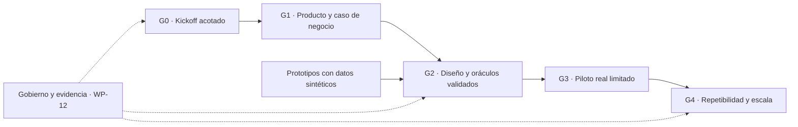

# Plan integral de mejoras del proyecto

**Revisión:** 16/10/2026 UTC. **Línea base examinada:** `2e5d579103b94ab70c16d81debe73bf5840ba0c8`. Las fuentes regulatorias y de mercado conservan su corte del 15/10/2026; esta revisión no acredita una actualización jurídica exhaustiva al día siguiente. **Estado del plan: Propuesto.** Responsables, inversión, contrataciones y aceptaciones institucionales no están designados/aprobados por crear este archivo.

## Diagnóstico ejecutivo

El proyecto cuenta con una biblioteca de diseño sólida: mercado con supuestos identificados, perímetros regulatorios diferenciados, ocho ADR, trece familias NFR, 1.016 FR en 32 módulos, 24 flujos integrados y 24 skills en la línea base. Son fortalezas la autoridad financiera SQL, dinero exacto, prevención de doble efecto, tratamiento de ambigüedad externa, aislamiento jurídico, migración preparada y distinción entre propuesta y evidencia. Conviene conservarlas.

El siguiente incremento de valor está en **seleccionar un producto comprable y demostrar un circuito completo con economía, contratos, políticas y operación verificables**. Aumentar otra vez el catálogo funcional no resuelve esa decisión. No se acreditan en el repositorio aplicación bancaria, contratos/clientes, equipo financiado o ensayos operativos; esto limita las conclusiones sobre rentabilidad y preparación de producción, sin probar qué existe fuera del alcance examinado.

La revisión identifica **63 hallazgos: 37 P0 condicionados al hito afectado y 26 P1**. P0 no significa incidente actual ni exige resolver los 37 para iniciar investigación/desarrollo sintético. Cada hallazgo conserva activador, fuente, impacto, acciones y criterio de cierre en los [registros especializados](README.md). El [backlog](backlog.json) los relaciona con 14 paquetes para evitar tratarlos como 63 proyectos independientes.

Las cinco decisiones que más condicionan la inversión son:

1. **Primer comprador y producto.** Elegir una ruta y un manifiesto de primera entrega financiable. La biblioteca integral sigue siendo referencia, sin convertirse en promesa de entrega simultánea.
2. **Caja y contribución por cliente.** Calendarizar venta, implantación, aceptación, facturación y cobro; cotizar celda, soporte, terceros, mantenimiento normativo y salida. El escenario base del mercado ya advierte que no cubre su estructura fija ilustrativa; falta decidir cómo cerrar esa diferencia.
3. **Perímetro, contratos y derechos.** Identificar proveedor/operador regulado y cerrar modalidades de venta, GPL/IP, datos, terceros y responsabilidad. GPL v2 permite actividad comercial; no equivale a una prohibición de SaaS ni habilita compromisos propietarios incompatibles sin analizar derechos y entrega.
4. **Diseño suficientemente concreto para verificarlo.** Definir contratos de estados/API, modelo de datos y guardianes SQL, políticas contables y oráculos independientes, corte multifuente y recuperación de hechos locales ante pérdida regional.
5. **Equipo y evidencia operativa.** Sustentar guardia, segregación real de personas, recuperación de identidad/claves, día de negocio, incidentes, migración y salida antes de asumir el compromiso correspondiente.

## Recomendación de producto y forma de decidir

Usar como primera hipótesis a validar un **servicio acotado de administración de crédito/cartera y conciliación para un prestamista o una cartera segregada**, con el prestamista/custodio y los reportes expresamente identificados. Puede permitir un circuito profundo sin activar desde el inicio toda la infraestructura de cuentas de pago, tarjetas o banca universal. Es una recomendación de investigación: no acredita menor costo en cualquier caso, demanda, licencia ni exención regulatoria.

Mantener pagos como alternativa si los compradores, acceso a contrapartes y margen muestran mejor viabilidad. No iniciar ambas rutas por la sola existencia de FR. Comparar con un motor comprado/asociado bajo igual perímetro, localización, servicio, derechos y salida; el TCO hipotético de un banco comprador no decide la economía del fabricante.

| Alternativa | Evidencia necesaria para elegir | Dependencias que no desaparecen |
|---|---|---|
| Crédito/cartera | Problema de servicing cuantificado, disposición a pagar, contratos compatibles y datos migrables | Contabilidad/impuestos del sujeto, KYC/AML según alcance, cobranza, reportes, privacidad y operación |
| Pagos/cuentas de pago | Comprador y volumen viable, acceso a bancos/rieles, respaldo/custodia y costo por celda/servicio | Autorización por rol, protección de fondos, fraude, ambigüedad, conciliación, reloj del riel y soporte |
| Banca integral/extensiones | Cliente, financiación, capacidad especializada y beneficio que justifiquen la amplitud | Licencias, múltiples integraciones, prudencia, red/mercados, migración y operación de cada especialidad |

No fijar precio, fecha productiva o SLO desde esta tabla. Cada elección necesita evidencia y decisión del responsable. Los criterios de dos clientes de diseño compatibles del mercado siguen siendo una puerta propuesta, no entrevistas o contratos ya obtenidos.

## Paquetes de mejora

Los IDs WP son estables. Las rutas indicadas como «a producir» son entregables planificados; su existencia o aprobación no se presume. Cada paquete remite en [backlog.json](backlog.json) a los hallazgos que justifican su alcance.

| Paquete | Responsable sugerido / hito | Cambio concreto en la documentación y trabajo necesario | Evidencia para cerrar |
|---|---|---|---|
| **WP-01 — Producto inicial y alcance** | CEO + Producto + Cumplimiento / G1 | Completar [charter](templates/project_charter.md); resolver ICP, sociedad/rol, ruta, flujos incluidos/excluidos y manifiesto de FR/dependencias. Incorporar decisión a mercado §12 y alcance funcional | Problema/cliente objetivo y exclusiones motivados; dependencias materiales con dueño/costo; condiciones por licencia preservadas |
| **WP-02 — Demanda y proceso de compra** | Comercial + Producto / G1 | Convertir hipótesis de mercado en censo deduplicado, entrevistas y pipeline; identificar comprador económico, operación, TI, Legal/Seguridad y compras, con presupuesto/decisión y fechas fundamentadas | Evidencia de compradores compatibles y siguiente decisión por oportunidad; conversión y ahorro distinguen dato, supuesto y medición; un legado activo no se computa como ahorro retirado |
| **WP-03 — Economía, precio y administración del proveedor** | CEO/CFO + Contador / G1 y contratación | Completar [caso de negocio](templates/business_case.md), separar segmentos/cohortes; definir mínimo/bandas/consumo, alcance de soporte, margen de implantación y recurrente. Especificar ciclo consumo–factura–cobro neto–retenciones–caja mediante ERP/integración, no ampliando el core a un ERP | Modelo mensual reconciliable, cotizaciones/capacidad y financiación trazables; precio sostenible bajo sensibilidad aprobada; perfil fiscal propio y medición/devengo/cobro diferenciados |
| **WP-04 — Contratos, GPL/IP y promesas** | Legal + CEO + Comercial / antes de oferta vinculante/entrega | Preparar MSA/SOW/SLA/DPA y aceptación, límites y salida; decidir derechos/procedencia/contribuciones y modalidad SaaS/instalación. Determinar estándares/aseguramiento realmente contratados | Política de derechos y ejemplo de entrega compatibles con LICENSE y titularidad; cláusulas enlazadas a alcance/FR/NFR/evidencia; certificaciones pendientes no se venden como obtenidas |
| **WP-05 — Contabilidad e impuestos del primer producto** | Contador del perfil + Producto + QA / G2 | Concretar políticas, plan de cuentas/asientos y vectores de LED/INT/TAX/RSK/RPT; distinguir PNFC/EF, costo contractual/CFT y rendimiento/medición contable, previsión regulatoria y deterioro | Paquete por evento con importes exactos, fechas, redondeos, cuentas y salidas revisadas independientemente; cierre/rectificativa y conciliación pueden explicarse de extremo a extremo |
| **WP-06 — Contratos técnicos y modelo de datos** | Arquitectura + Ingeniería + Datos / G2 | Desarrollar contratos API/estados y modelo lógico SQL del primer flujo, protocolo de guardianes y revocación; resolver secuencias filtradas/replay, barreras SQL/fuentes y consistencia SQL/objetos de evidencia. Ampliar ADR afectados sin aceptarlos ficticiamente | Transiciones y errores normativos con datos/versión; historias concurrentes tienen un orden válido; barrera prueba completitud por fuente; documento faltante no puede presentarse como contrato/evidencia íntegros |
| **WP-07 — Plataforma, recuperación y presupuesto de capacidad** | Arquitectura + SRE + CFO / G2 y antes de SLO | Contrastar ofertas reales de servicios/regiones/países, garantías de persistencia/HA, costo mínimo y capacidad. Concretar backlog/WAL/catch-up y pérdida regional de hechos confirmados localmente, incluidos movimientos internos sin riel | Por clase, identificar fuente sobreviviente o pérdida no reconstruible y tratamiento compatible con obligaciones; si el perfil no la admite, ajustar persistencia/topología o restringir activación. Ensayo posterior observa RTO/RPO y límites; documentar riesgo no demuestra recuperabilidad ni habilita prometer RPO regional cero |
| **WP-08 — Amenazas, identidades y desarrollo seguro** | Seguridad + Arquitectura + Ingeniería / antes de aprobación sensible o datos reales | Crear modelo de amenazas/fronteras y matriz de autorización; reforzar IAM007 y controles con identidad de persona/control delegado, no sólo principal. Diseñar bootstrap/recuperación IAM–KMS–control plane y evidencia de cadena de suministro/SDLC | Dos credenciales de la misma persona no eluden doble intervención; cambiar destino/importe invalida aprobación. Un rol alternativo recupera control/claves sin dependencia circular; release muestra procedencia, revisión y pruebas en su alcance |
| **WP-09 — Aceptación y evidencia QA** | QA + Producto + responsables contables/operativos / G2–G3 | Seleccionar denominador del piloto y matriz FR/NFR–caso–riesgo–oráculo–evidencia; crear fixtures monetarios/temporales, historias de carreras/rieles y campaña representativa de carga/fallo. Usar [registro](templates/evidence_register.md) | Resultados esperado/observado y entorno/versiones reproducibles; integridad/autorización/ambigüedad/conciliación/recuperación no se compensan con un promedio de casos aprobados. Producto no implementado permanece sin evaluar |
| **WP-10 — Equipo, kickoff y día de negocio** | Responsable de entrega + Operaciones + SRE + Cliente / G0 y G3 | Completar RACI/capacidad/suplencia y presupuesto de guardia. Preparar agenda intradía/cierre, ajustes manuales, reclamos/AML/incidentes y relojes; instanciar contingencias preventivas por operación/riel y SLA proveedor–entidad | Otra persona ejecuta runbooks con permisos y facultades reales; ausencia del titular tiene suplencia; pruebas de mesa/con posterior ejecución preservan relojes y constancias. Desarrollo sintético no se anuncia como servicio 24×7 disponible |
| **WP-11 — Terceros, datos y mantenimiento regulatorio** | Cumplimiento + Legal + Seguridad + Operaciones / antes de tercerizar/transferir/activar | Poblar cadena de servicios/países/acceso/retención/originales, DPA y derechos de auditoría/salida; calendarizar avisos por sujeto/servicio. Definir responsable y alcance contractual del mantenimiento normativo y transiciones | Fuente/aplicabilidad/versión/regla/cambio/evidencia trazables; país de DB no oculta soporte/telemetría/DR; restauración no repone difusión vencida ni destruye hold; documentos/avisos reales del caso cuando sean exigibles |
| **WP-12 — Gobierno de FR, skills y documentación** | Producto + Arquitectura + QA / desde G0 | Evolucionar el generador para estados/retiros sin renumerar, manifiestos versionados y diffs semánticos. Validar todos los links/skills/metadatos y revisar propagación inversa cambio→FR→NFR/ADR→caso/evidencia→skill. Mantener pocos workflows | Retirar un ID conserva historia y excluye cobertura activa; fuentes/capacidades quedan cubiertas por reemplazo o con brecha. Borrar una capacidad del denominador requiere justificación; validación estructural no se presenta como revisión semántica |
| **WP-13 — Coexistencia, migración, retorno y salida** | Migración + Operaciones + Cliente + QA / antes de corte | Especificar cierre de autoridad/época y callbacks en vuelo; ensayar snapshot/deltas/transacciones completas, PREPARED, conciliación y activación. Probar retorno con actividad nueva y exportación/restauración independiente | Un escritor por contrato, ninguna exposición PREPARED, apertura/historia excluyentes, cero diferencias inexplicadas y pendientes externos preservados. Medir ventana completa/costo; volver al legado no borra liquidaciones |
| **WP-14 — Valor, repetibilidad y expansión** | CEO + Producto + Comercial + Operaciones / G4 | Completar paquete de compra/due diligence con evidencia sanitizada, retorno del piloto y soporte real; comparar segundo cliente sobre producto común, sustitución de partners y pérdida de cliente principal | Menor trabajo específico sin forks materiales, margen/caja sostenibles y operación compatible; sólo expandir productos/países al demostrar financiación, controles y capacidad. No fabricar casos o certificaciones de referencia |

## Orden y dependencias

La prioridad de ejecución se determina por el próximo compromiso, no sumando severidades. WP-01/02/03/04 informan la decisión de inversión; pueden investigarse en paralelo con prototipos sintéticos de WP-05/06/08/09. Las decisiones y pruebas específicas del piloto se instancian después de fijar su perfil. WP-12 acompaña el trabajo desde el inicio.

| Hito | Condición y decisión | Estado observado |
|---|---|---|
| G0 — Kickoff | Charter provisional, roles de trabajo propuestos, accesos mínimos, datos sintéticos, backlog y dependencias. Puede prepararse con la información actual | Este plan y plantillas ayudan a prepararlo; personas/capacidad/accesos todavía no acreditados |
| G1 — Inversión/oferta | Segmento/ruta, evidencia de compra, build/buy, derechos, caja y economía del perfil; un responsable decide sobre supuestos y límites explícitos | Pendiente; escenarios existentes son ilustrativos |
| G2 — Diseño validado | Perímetro del caso, políticas/contratos/amenazas/modelo de datos, plataforma y oráculos revisados; ADR/decisiones con evidencia real de aceptación si se aprueban | Diseño general propuesto; falta concreción del caso y su revisión |
| G3 — Piloto real | Integraciones/contratos aplicables, controles medidos, evidencia QA, guardia y operaciones, corte/retorno/DR/salida, exposición limitada y decisión de responsables | No acreditado en el repositorio; documentos no equivalen a software o ensayo |
| G4 — Escala | Segundo cliente sobre base reutilizable, margen/caja, costo/tiempo de entrega y controles sostenibles | No evaluado; no lo prueba un ARR hipotético |

Las obligaciones legales aplicables no se dispensan con aceptación interna de riesgo. Una dependencia pendiente restringe el hito afectado; no introduce una aprobación general para análisis, documentación o desarrollo independiente ya autorizado. Los intervalos ilustrativos del mercado no se transforman aquí en fechas comprometidas.

## Primeros diez días hábiles de trabajo: agenda propuesta

Esta secuencia sirve para organizar un kickoff; no acredita disponibilidad de personas ni promete producción en diez días. Cada tarea necesita responsable/capacidad real y puede cambiar por evidencia.

| Orden | Trabajo | Salida verificable |
|---|---|---|
| Días 1–2 | Revisar diagnóstico con responsables; completar charter provisional; seleccionar hipótesis de cliente/ruta y preguntas que la invalidan | Alcance de descubrimiento, alternativas, decisiones pendientes y backlog inicial con responsables sugeridos |
| Días 2–5 | Preparar investigación comercial y escenarios de precio/caja; solicitar cotizaciones por los canales autorizados; revisar GPL/IP y modalidad contractual | Protocolo de entrevistas/RFI, modelo con supuestos, costo mínimo pendiente/cotizado y decisión legal a resolver. No se contacta a terceros por este documento |
| Días 3–6 | Taller de un flujo financiero: política/asientos/oráculo, API/estados, SQL/guardianes, amenazas y contingencias | Paquete sintético revisable y lista de desacuerdos; sin dar aprobación contable o jurídica por supuesta |
| Días 5–8 | Definir pruebas/historias y registro de evidencia; completar RACI/agenda del perfil y mapa de terceros/datos | Matriz de aceptación, historias de fallo, responsabilidades y costos, con pendientes visibles |
| Días 8–10 | Consolidar evidencia disponible y valorar G1/G2; decidir siguiente incremento, asociación, reducción o continuidad de descubrimiento | Decisión real cuando exista responsable competente; revisión actualizada del plan y presupuesto, sin calendario productivo fabricado |

## Otras perspectivas incorporadas

- **Producto y experiencia:** priorizar un recorrido de usuario/operador completo; conservar accesibilidad, mensajes fieles de estado y tratamiento de reclamos en el perfil activo. Un volumen de FR no mide valor entregado.
- **Datos:** definir propietarios, calidad, contratos, barreras y linaje de fuentes; SQL/objetos/reportes deben poder demostrar el mismo hecho, incluido el estado incompleto.
- **Personas y gobierno:** financiar revisión independiente y suplencia; una persona puede ejercer funciones compatibles, pero dos credenciales no crean independencia. La disponibilidad y el conocimiento no pueden depender sólo del autor.
- **Cadena de suministro e IP:** compatibilidad de derechos, procedencia, auditoría/supervisor y salida forman parte del producto vendible y del costo. Incorporar seguros/responsabilidades sólo tras análisis de exposición y contrato, sin inventar obligación universal.
- **Mantenimiento del conocimiento:** conservar fecha y autoridad de fuentes, evidencia de cambios y regresión de skills; no copiar objetivos NFR en múltiples checklists que diverjan.

## Mejoras concretas incorporadas con esta revisión

Se agregaron los seis diagnósticos especializados, registros de hallazgos y este plan; un inventario trazable de los archivos de la línea base; plantillas de charter, caso de negocio y evidencia; y tres workflows locales: [revisión integral](../../.agents/skills/core-project-review/SKILL.md), [ciclo de FR](../../.agents/skills/core-fr-requisitos/SKILL.md) y [kickoff/piloto](../../.agents/skills/core-pilot-kickoff/SKILL.md). Se enlazan con los coordinadores existentes y el índice de skills.

También se añade una verificación documental transversal y su workflow de CI, descritos en [el índice](README.md). Revisan estructura, enlaces, metadatos, inventario y relaciones del plan. **No reparan todavía el ciclo de retiros del generador FR ni detectan toda deriva semántica**; esas acciones permanecen en WP-12. Las pruebas de mutación del informe QA describen límites reales de la herramienta original, conservando el diagnóstico sobre la línea base.

Estas mejoras preparan el trabajo y permiten auditar el plan. No cierran los 63 hallazgos por la mera creación de documentos/skills, no modifican la licencia y no aceptan ADR/NFR, contratos, inversión, condiciones fiscales o puesta en producción en nombre de la entidad.

## Seguimiento y criterios de cierre

Actualizar por paquete: responsable designado, estado, siguiente acción, dependencia, presupuesto y fecha fundamentada; conservar vínculos con los hallazgos de origen. En cada hito revisar decisiones y evidencia proporcional al riesgo. Medir además conversión de oportunidades calificadas, margen por cliente/celda, caja y capacidad de entrega, plazo/costo de implantación, defectos materiales, diferencias de conciliación, disponibilidad observada y carga de soporte.

No fijar umbrales inventados: aprobar los económicos desde el caso de negocio y los técnicos desde NFR/BIA/contrato aplicable. Un hallazgo se cierra con su criterio y evidencia revisada, no al añadir otro porcentaje o un nombre de responsable. Conservar resultados negativos, limitaciones y fecha/disparador de reevaluación.
